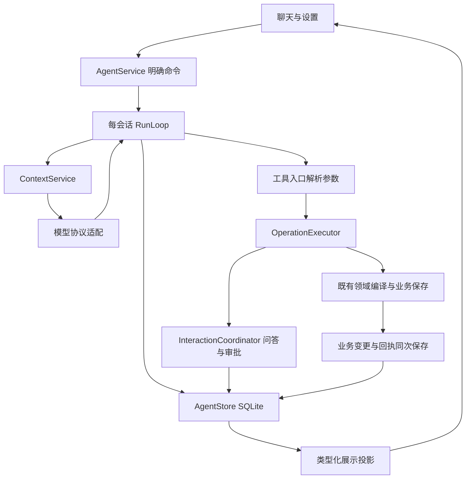

# Agent 架构

Sked 使用内置 Dart Agent，复用课表、日程、设置与平台服务。一个 Agent 管理多个会话；每个会话有独立执行对象、消息、队列和工作上下文。界面保留 Material 3，按用户输入、过程说明、紧凑活动和最终答复组织内容。

相关说明：[运行流程](AGENT_RUNTIME.md)、[能力目录](AGENT_CAPABILITIES.md)、[聊天交互](AGENT_CHAT_DESIGN.md)、[上下文与模型](AGENT_MODEL_SELECTION.md)、[历史重做](AGENT_HISTORY.md)、[备份](SELECTIVE_BACKUP.md)。实施状态与平台证据记录在[实施计划](AGENT_IMPLEMENTATION_PLAN.md)。

## 执行链与职责

| 组件 | 所有权与职责 |
| --- | --- |
| `AgentApplication` | 组合连接、工具、业务适配器、共享数据库及生命周期 |
| `AgentService` | 接纳发送、排队、补充、停止、继续、重生成、重做及压缩命令 |
| `ConversationExecution` | 持有当前会话的一份执行记录，向当前会话发布状态 |
| `RunLoop` | 组装上下文、请求模型、调度工具、保存结果，继续或结束 |
| `OperationExecutor` | 从一次业务调用完成编译、权限决策、保存和结果返回 |
| `InteractionCoordinator` | 统一问答与审批的保存、答复、取消及恢复 |
| `ContextService` | 当前请求计量、历史选择、自动与手动压缩 |
| `AgentStore` | 保存事实记录，提供事务、分页、知识与上下文检查点 |

[AgentService](../lib/agent/runtime/agent_service.dart) 通过明确命令进入流程，不用多个布尔参数组合执行模式。运行对象持有取消、模型请求、待决交互及已接受写入的归属。离开页面或切换会话保留应用级执行，界面订阅相应会话的展示状态。

异常在负责该结果的边界处理：参数错误回送模型纠正；真实服务错误保留原因；保存状态以持久回执为准。运行没有累计 Token、轮数、工具次数或普通任务时限配额，用量单独保存。只读调用无依赖时并行，有依赖的写操作顺序执行。

## 一次业务修改

模型使用 `mutation.apply`、`settings.update`、`operations.undo` 等业务工具。宿主生成操作身份，在业务写入前登记调用关联，然后完成领域编译、权限处理、保存与回执返回。内部编译和提交方法不进入模型工具目录；模型无需填写或抄写操作 ID。

三种权限共享同一调用：计划模式返回影响预览；确认模式在当前调用内等待用户决定；完全权限执行已经请求的动作。审批说明业务影响，例如创建课表并设为当前课表。用户拒绝或取消产生明确结果，模型参数不构成批准。

`ToolOutcome` 区分查询、预览、已保存、取消、可纠正错误和待核对结果。未知工具、错误参数及目标变化正常返回工具结果，模型可继续纠正。业务已保存后，即使聊天投影写入失败，也保留真实保存状态和操作关联，不能改判为普通失败并重做业务写入。

参数在工具入口解码；真实资源归属和业务规则由领域层处理；存储确认实际落盘结果。参数 schema、模型配置解码与字段说明共享元数据。资源以稳定 ID 寻址，名称只用于检索和展示。

## 主库回执与并发

课表和日程继续沿原业务入口保存。主库在同一事务内保存业务变更与 `ApplicationLedger` 回执；Agent 库记录工具与结果。恢复时读取主库实际回执，不靠聊天文字推断是否执行，也不重新执行已经保存的操作。

主库格式随账本调整及模型上下文配置升级到 v8，保留业务数据升级路径。账本不按固定条数或字节数淘汰、阻断其他写入。操作身份由宿主生成，实际提交顺序在保存时分配；另一会话的无关提交不会使等待确认的操作身份失效。

等待确认期间，当前操作持有候选。保存前针对实际对象重编译并比较审批影响；无关编辑被保留，目标或影响发生变化则返回冲突。固定的批量目标不会在提交时重新筛选并吸收后来新增的对象。单次批量业务修改是一次事务。

跨存储和平台动作使用各适配器的真实结果证据。业务保存、提醒排程失败和无法观测实际通知投递是不同事实；未知通知投递不把已保存业务降级为失败。历史重做按照真实提交顺序撤销，并复用持久回执避免重复执行逆操作。

## SQLite 与附件

[AgentDatabase](../lib/agent/store/agent_database.dart) 使用 Drift/SQLite。原生数据库在后台 isolate 工作；`agent_conversations` 保存索引和会话元数据，`agent_items` 按集合、所属会话和稳定身份保存事实行，元数据表保存版本及切换状态。消息、工具调用、操作、交互、队列、摘要和历史版本通过事务关联更新。

页面读取最近的完整消息与工具组，再向前分页。更新只保存发生变化的行；完整导出、撤销、重做及修改会话前按需加载完整事实，分页缓存不会覆盖未加载的历史。会话统计直接查询行数和用量记录，无需读取全部消息正文。

会话字段及引用在共享模型中验证，验证失败不进入数据库写入。事务明确回滚后保留原快照可写；提交结果未知时重新加载实际记录。恢复历史的全局执行边界持久保存，分页读取按当前页位置换算。

原始消息、模型工作上下文和界面折叠状态各自保存。流式增量缓冲后按帧发布，只更新当前会话。附件元数据入库，二进制独立保存；上传使用流式读取、编码及请求体，进度与取消贯穿整个流程。文件引用回收查询数据库中的全部引用，不只检查当前加载页。

Web 使用匹配版本的 SQLite wasm 和 Drift worker。`web/sqlite3.wasm`、`web/drift_worker.js` 来自 [Drift 2.35.3 发布资产](https://github.com/simolus3/drift/releases/tag/drift-2.35.3)，worker 源入口见 [tool/drift_worker.dart](../tool/drift_worker.dart)。浏览器没有持久存储能力时明确报告错误。

## 上下文

最大上下文长度、自动压缩触发 Token 数和自动压缩开关按模型保存。用户填写值优先，其次使用明确模型元数据；已知窗口默认触发点为 80%，未知窗口显示未设置。手动菜单和 `/compact` 调用同一服务，运行中的请求进入持久控制队列，在完整工具组边界处理。

计量覆盖系统指令、工具定义、消息及附件估算。当前请求估算与服务报告输入用量分别显示，不累加历次请求作为当前窗口占用。运行使用所属模型标识；同一模型的最新压缩设置在下一次请求生效。

摘要保存目标、约束、决定、结果、待办与引用，近期原文保留完整工具配对。摘要及来源范围保存成功后才切换工作上下文。失败或取消保留原文，提供重试；同一份失败来源不会在下一次请求或重启后反复自动总结。编辑重做、引用与模型变化按新的来源范围重建上下文。

## 知识、连接与生命周期

共享 Skills 按任务提供操作指导，能力按需发现，普通业务查询不等待知识库加载。内置 Skills 使用单次业务调用契约；自定义 Skills 和记忆保存到 Agent 库。连接、凭据、功能启用及用户设置继续由原所有者管理。凭据保存在平台安全存储，模型只接收状态和引用。

旧 Agent 聊天、附件、自定义 Skills 和记忆在确认未决写入后重建；内置 Skills 重新装载。切换读取旧侧库回执证据，并处理已经接受的历史撤销及选择性恢复 journal，再退役旧文件。证据缺失时保留相关文件和可核对状态。业务数据、连接、凭据和用户设置保持原有升级路径。

新版 Agent 备份使用明确版本，恢复不重放待确认操作。清空通过维护流程等待其他执行结束，排除发起清空的当前执行，关闭数据库后删除文件；迟到的活动记录不能重新创建已经清空的数据库。

## 验证

数据库、领域保存、协议模拟、组件、原生平台和真实模型分别验证。关键结果包括单次修改的操作身份和业务终态一致、三种权限只产生一次决策、队列与补充顺序正确、停止和重启不重复保存、分页不丢历史、压缩失败保留上下文、长数据越过旧门槛仍能执行。

Windows 宽窄窗口与 Android 的键盘、深浅主题、2× 字号、RTL 和阅读位置通过原生旅程验证。真实模型使用现有连接及合成业务数据；性能比较固定源码、数据和协议，记录消息加载、SQLite 写入、流式更新与滚动的实际结果。
