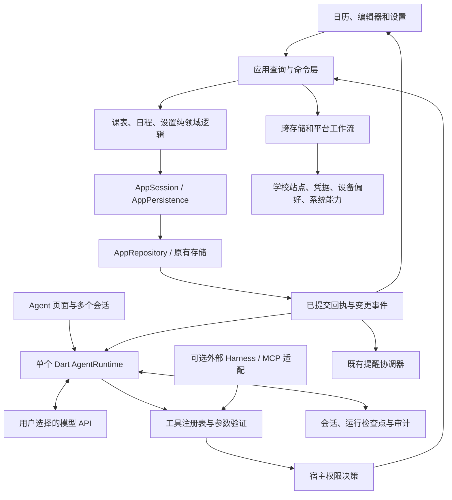

# 全软件 Agent 架构提案

状态：内置运行时、全域工具、双端会话界面、共享 Skills 和旧 AI 入口替换已接通；本轮收尾后暂停，P8 尚未通过。源码研究日期：2026-10-29；产品范围修订：2026-10-30。源码研究基线：`ea784f3a16e5d4a23aedae410544492fb6fa0f6f`（Sked 2.3.0）。本文区分当前实现与后续设计：真实 API 已观测到成功和未完成任务，浏览器协议/存储及 Android 模拟器页面已有隔离验收入口；完整模型任务质量、成本、性能与实体设备验收仍待完成，不能由局部通过推导发布就绪。

相关文档：[能力全集](AGENT_CAPABILITIES.md)、[数据与应用重构](AGENT_DATA_REFACTOR.md)、[共享 Skills](AGENT_SKILLS.md)、[开源 harness 研究](AGENT_HARNESS_RESEARCH.md)、[实施计划](AGENT_IMPLEMENTATION_PLAN.md)。当前已发布行为仍见[使用逻辑](USAGE_LOGIC.md)、[可靠性约束](RELIABILITY_BASELINE.md)和[工作台规范](ADAPTIVE_WORKSPACES.md)。

## 1. 产品目标与已确定方向

Sked 内置一个 Agent，用户可以新建多个会话。所有会话使用同一套应用能力和共享 Skills，各自保留消息、草稿、上下文和执行结果。Agent 能查询、创建、修改、删除全部课表、课程、日历分类、日程，以及管理全部用户可配置项；复杂任务可以连续调用工具完成。自然语言成为完整操作入口，现有表单和日历继续提供精确编辑与离线使用。

已确定的产品方向：

- **跨平台内置 Agent，用户自选模型 API。** 手机与桌面共享 Dart 运行时和应用工具；运行不依赖用户另装 Node、Python 或某个命令行 harness。
- **一个 Agent、多个会话。** 不提供创建、复制、管理多个 Agent 身份的功能；不设计每个 Agent 独立的记忆、Skills 或权限档案。
- **功能管理控制启用与显示。** 一个 Agent 开关控制正式入口和执行可用性；手机端是完整的 Agent 页面，页面中可新建、切换和管理会话。
- **权限只有三种。** 只读计划模式、每次修改前询问、完全权限模式。完全权限允许连续完成全部应用操作，包括批量删除、清空和恢复，无应用级逐次审批。
- **统一所有 AI 业务。** 独立文字课表解析页移除，内容直接发送到会话；网页保留压缩、校对，再新建 Agent 会话解析导入。原专用解析 API、设置和执行页面退役。
- **封装丰富的共享 Skills。** 按任务组织操作指导，按需加载，使用确定性的应用工具完成真实修改；所有会话共用同一技能包。

“全部”包括非当前课表、隐藏日历、停用工作区中保留的数据、共享节次时间集、学校站点、设备布局和 Agent 自身配置。全量可管理不等于每次向模型发送全库内容。设置删除使用恢复默认或清除显式值；资源删除使用领域删除命令。

凭据可添加、替换、关联和删除，由宿主安全输入与安全存储完成；模型读取凭据状态和引用。系统权限的真实状态、用户同意事实和内部一致性标记不属于任意可改的配置。Android 系统授权仍由系统处理。

## 2. 当前源码基础与实际缺口

| 当前基础 | 可以复用 | 必须补齐 |
| --- | --- | --- |
| [AppRuntime](../lib/app_runtime.dart) 组装命令、视图、会话与仓储 | 明确的组合根及共享生命周期 | 应用级 AgentRuntime，不由某个面板持有运行权 |
| [StudentCommands](../lib/controllers/student_commands.dart)、[GeneralCommands](../lib/controllers/general_commands.dart)、[SettingsCommands](../lib/controllers/settings_commands.dart) | 已有业务入口及纯领域服务 | 显式目标、严格输入、结构化结果、统一预览和冲突检查 |
| [AppSession](../lib/controllers/app_session.dart)、[AppRepository](../lib/data/app_repository.dart) | 唯一可写快照、排队保存、实际保存回执、已提交事件 | 命令幂等、跨重启版本、纯数据批事务、审计和撤销 |
| [GeneralCalendarService](../lib/services/general_calendar_service.dart) | 重复实例的本次／以后／全系列变换及一次保存 | 工具协议直接复用这些语义，覆盖普通修改和删除的版本前提 |
| [助手宿主](../lib/widgets/assistant_pane.dart) | 桌面布局、宽度与焦点约束 | 已改为访问应用持有的真实会话；关闭面板不结束运行 |
| [ProviderClient](../lib/agent/provider/provider_client.dart) | 承接旧 SchoolImportApi 的有界网络、取消和敏感请求保护 | 旧专用 AI 请求链路已退役；纯候选解码位于 Agent 导入层 |
| [SecretStore](../lib/services/secret_store.dart) | 平台安全存储与已有密钥迁移路径 | 当前活动连接的凭据引用、端点绑定、替换/清除及读取结果脱敏 |

不能把现有命令直接全部注册为工具：部分入口对不存在的对象静默返回；保存日程可能回退到当前分类；部分校验仅在编辑器中。现有 agenda 投影也默认使用当前课表或筛掉隐藏/停用来源，不能承担“查询所有”。完整差异见[能力全集](AGENT_CAPABILITIES.md)。

当前 `AppDataVersions`、仓储 batch revision 是进程内版本，不是跨重启幂等凭证。保存队列已有的少数偏好合并也不等于通用批事务。

## 3. 实现结构与后续边界



应用命令层是软件行为的稳定底座，AgentRuntime 负责理解任务、调用模型、选择工具和推进会话。模型不修改存档文件，不持有另一份可写 AppData，也不通过切换界面选中对象完成寻址。

当前通过存档/便携备份编码、领域模型和 `ResourceQueries` 投影区分存储与模型输入；提案中的 AgentProjectionCodec、FieldSpec 等名称并非均被采用。模型使用摘要/详情/编辑视图、按需字段和语义 patch；磁盘保留完整、可恢复的领域表示。接口已减少不相关字段的传递，真实任务 token 收益仍需测量；稀疏存储、课程身份拆分或 SQLite 分别评估。[数据与应用重构](AGENT_DATA_REFACTOR.md)记录具体字段、兼容陷阱及历史合成表示对照，不把省字节、省 token 和运行正确性合为一个指标。

当前主要代码边界：

```text
lib/application/
  resource_queries.dart          # 全域、有界、可分页的查询
  resource_contracts.dart        # 查询 DTO、引用与错误
  resource_mutations.dart        # 严格资源命令与纯候选编译
  mutation_coordinator.dart      # 计划、提交、持久回执与撤销
  operation_contracts.dart       # 三模式、授权与执行作用域
  setting_registry.dart          # 所有偏好及 reset 语义
  external_operation_coordinator.dart # 跨存储与平台回执
lib/agent/
  agent_application.dart        # AppRuntime 持有的组合与生命周期
  connection/                   # 当前连接、凭据、迁移和诊断
  conversations/                # 会话、来源、保留与删除
  runtime/                      # 循环、队列、取消、上下文、预算
  provider/                     # API 协议适配，不依赖 Widget
  tools/                        # 领域工具 schema 与映射
  imports/                      # 不可变来源、候选解码与网页交接
  skills/                       # 共享技能目录和按需装载
  ui/                           # 双端共用会话与连接配置界面
```

先用明确模块边界实现，不为拆包而迁移全部现有代码。已有 controllers 和 services 逐步适配，纯重构与行为变化分开。数据库整体替换、UI 重写不是该方案的前置条件。

## 4. 单个 Agent 与多个会话

| 对象 | 主要字段 | 生命周期 |
| --- | --- | --- |
| `AgentSettings`（单例） | 功能启用、默认模型连接、默认执行模式、共享指令、预算、历史保留偏好、配置版本 | 修改/reset；启用开关位于功能管理，无 Agent 身份 CRUD |
| 当前模型连接 | `AgentSettings` 中的协议、规范化 endpoint、model、credentialRef 与配置版本 | 配置、替换、清除、诊断和模型列表；当前提供一个活动连接，不提供多个连接 profile 列表 |
| `AgentConversation` | ID、标题、消息、来源附件、当前执行模式和运行引用；上下文摘要从历史重建 | 新建、切换、重命名、归档、导出、删除；不需要 agentId 外键 |
| `AgentRun` | conversationId、用户请求、状态、连接/配置/模式版本、数据世代、预算、工具回执、检查点 | 支持停止、继续、失败恢复；完成依赖真实工具结果 |
| `SharedSkillPack` | 清单、技能 ID/版本/正文、工具依赖、兼容范围 | 应用统一发布、按需加载；不是每个会话安装一套 Skills |

单例 Agent 设置可通过统一设置能力管理，执行模式提升必须来自用户在宿主中的明确选择，不能由模型修改自身配置提权。各会话互不混入消息、附件和未完成计划；共享配置、应用数据和 Skills 只有一套。长期记忆不作为本期必需的独立产品系统；会话历史和摘要足以支撑首期任务连续性。

会话基础现由 `ConversationRepository` 提供独立于主库的顺序持久化，已接入应用持有的模型循环及手机/桌面共用界面：会话/草稿/模式相互隔离，网页 handoff 映射、来源和首条消息原子保存，同 ID 的不同材料/目标/请求拒绝重用。原生存储使用应用支持目录内两个交替、校验和校验的文件，浏览器适配器使用两个本机键并读回确认；保存失败关闭继续写入，重启中的运行统一标记 interrupted，不自动重发模型请求或工具。删除正文/附件与终止 ID 同次保存，迟到运行结果不能复活会话。存档上限为 16 MiB、200 会话、每会话 1,000 消息/20 来源，超限明确拒绝。原生文件与浏览器内存适配测试不替代浏览器或实体设备验收。

运行开始冻结模型端点、凭据引用和设置版本。运行中改连接默认影响下一次运行；要在当前运行切换，先建立明确边界并记录事件。执行模式的收紧立即作用于后续未提交动作；不能因运行初始快照仍是完全权限而忽略用户切换到只读。避免改 URL 后把同一密钥或旧上下文自动发送到另一服务。

功能管理关闭 Agent 时隐藏入口、停止接收新请求并取消未提交步骤，已接受的落盘步骤完成结果核对；保留会话、输入草稿、连接设置和所有业务数据。重新开启恢复访问，不自动重放旧任务。普通退出 Agent 页面只改变页面显示；停止运行、删除会话和关闭功能分别处理，删除历史不撤销已完成的业务修改。

删除正在运行的会话时，先持久化会话终止标记并使其执行作用域失效，阻止新请求和未提交工具；取消模型请求，核对已接受业务写入的确定结果或结果未知状态，再清理本会话拥有的正文/附件。迟到响应、重启恢复和自动重试不得复活已删除会话。幂等需要的最小操作回执按既定窗口保留在操作层，不靠被删除的聊天历史去重；共享配置、Skills 和其他会话内容不随之删除。

## 5. 应用命令契约

### 5.1 查询与操作分开

已实现的实例命令沿用查询返回的 canonical occurrence Ref；修改、删除和复制必须指定本次、此后或整个系列。新分支 ID 在准备时由宿主固定；COUNT、UNTIL、月锚点、例外及提醒处理沿用现有服务语义，辅助记录变化纳入完整预览。实例定位采用有界 lazy 范围，避免长持续事件为定位一个实例先展开全部重叠历史。只管理隐藏或停用日程不切换当前 UI 工作区。

`ResourceQueries` 从调用方固定的数据快照提供只读 DTO，不输出包含运行时密钥的完整对象。查询明确资源/父资源范围、includeHidden、includeDisabled、日期范围与分页，返回世代、快照版本和完整性信息；宿主在快照变化后更换查询器。

先按课表/分类/事件 ID 与可前置的条件筛选，再展开相关实例。默认 summary 不含无关正文，detail/edit 按需补齐；省略字段不表示为空。数量、空闲和冲突由确定性聚合计算。批量操作可使用宿主持久保存的 selectionRef，绑定完整 ID 集合、数据世代和版本；短引用不等于行号或授权。

名称用于搜索；修改用稳定 ID。多个同名目标必须进一步解析。相对日期在运行开始绑定 `now`、本地时区、周起点和当前工作区上下文，工具返回最终绝对日期；跨午夜继续运行时显式刷新基准，不能把同一计划的“明天”解释成两个日期。

“管理停用域”是新增能力：显式管理命令可访问其保留数据，不切换 `activeMode`、不临时启用页面、不恢复该域提醒。原 UI 的停用约束保留；新的权限和查询边界应有独立测试。

### 5.2 统一准备与提交

拟议接口：

```dart
Future<PreparedMutation> prepare(AppCommand command, ReadContext context);
Future<CommandResult> commit(PlanHandle plan, TrustedExecutionContext context);
Future<CommandStatus> status(OperationId operationId);
Future<PreparedMutation> prepareUndo(ReceiptId receiptId);
```

`PreparedMutation` 包含规范化命令、固定目标 ID 集合、读写集合、资源版本、影响数量、业务语义变化、候选变更和执行类别。只读计划模式可以准备而不能提交；询问模式在每次修改前确认；完全权限模式连续 prepare/authorize/commit，不暂停审批。

`TrustedExecutionContext` 由宿主创建，包含会话身份、执行模式及其版本、runId、数据世代和幂等标识。它不是模型可填写的工具参数。`confirmed: true` 或模型自报模式不构成授权。

提交前在同一串行执行边界内重新验证目标、版本、权限与维护状态，再执行纯变换并一次保存。等待模型、网络或用户期间不持有数据锁。UI 也逐步进入同一命令入口，否则只串行化 Agent 仍会遗漏人与 Agent 的竞争。

开放 Agent 写入前，所有现存主库变更入口必须共享“读取—变换—提交”的协调边界，包括延后导航保存和维护。仅锁住最终保存不够：旧命令可能已经更新内存而尚未落盘，Agent 从 committedData 生成的整份候选会覆盖它。过渡期尚未迁移的入口必须可被检测，发现未托管变更或待写状态时拒绝 Agent 提交并等待重新读取；不能仅比较已提交 revision。

新建、修改、删除分别定义，修改不存在的对象不能变成新建；无效目标不能回退当前课表或分类。字段 patch 不允许通过整个分类对象意外覆盖全部 events。

设置工具使用唯一的 `settings.prepare(action: set/reset)` 准备契约和 `mutation.commit` 生效契约，避免把返回候选与返回已保存值混在同一接口。通知重排、文件写入、系统动作等专用工具也必须进入相同的模式判断与 OperationScope；若内部合并准备和提交，仍返回明确的未执行/等待/已执行状态，不能因工具名称不含 mutation 而绕过只读或询问模式。

共享 DraftCompiler 编译 keep/set/reset、课程时间来源和重复范围等意图，统一注入时钟与 ID。OperationScope 管实际执行，RouteScope 只管页面观察/关闭；页面销毁不能把已保存结果改成失败。设置的 FieldSpec 作为类型、范围、默认和 reset 的共同来源，工具 schema、描述和 Skills 依赖据此构建，组合不变量仍归领域服务。

### 5.3 结果由宿主生成

```json
{
  "operationId": "op-generated-by-host",
  "status": "committed",
  "createdIds": [],
  "updatedIds": ["event-17"],
  "deletedIds": [],
  "datasetGeneration": "generation-id",
  "commitRevision": 42,
  "effects": {"notifications": "pending"},
  "undoReceiptId": "undo-42"
}
```

该示例是拟议结果，不是当前返回值。数据成功保存与通知已显示分开表述。常用错误包括 `invalid_argument`、`not_found`、`ambiguous_target`、`version_conflict`、`stale_dataset`、`permission_denied`、`approval_required`、`unsupported`、`write_blocked`、`cancelled`、`outcome_unknown`。

只有需要用户选择的信息才进入询问状态；参数格式、限流等可修复错误交由有界重试或模型纠正。写入结果未知时先查询操作状态，不重复执行创建或删除。

## 6. 批量、一致性、幂等与撤销

### 6.1 同一主库的批事务

共享写入入口已提供 `AppSession.commitMutation`：先完成传入的延后保存并等待已接受写入，始终拒绝未保存 UI 草稿。标准资源/设置计划记录目标和语义读取依赖，固定 ID/时钟后在当前持久快照重编译，完整差异仍须与已审批内容一致；无关已保存编辑被保留，同对象或依赖变化仍冲突。宿主 prepareDraft、待提交撤销及跨 Agent 回执序列保留较严格的重新准备边界。取得短期写入所有权后重新授权并保存，其他旧 UI 写入口在落盘期间返回忙碌；保存失败遵循原回滚/恢复门禁。旧 UI 继续使用既有 commands 和共享纯服务，不宣称全部入口已迁为同一种 typed 返回协议。细节及回归见[运行行为](AGENT_RUNTIME.md)。

例如“把三张课表里周五下午的课程移到周四，同时调整默认提醒”应先固定课程 ID，计算所有变更和冲突，再生成一个候选 AppData 并单次提交。任一规则不满足则不写入。循环调用现有 `saveCourse` 不能达到这个契约。

计划需有字节、对象数和计算时间预算。超预算返回可选择的分批计划；分批后明确每批的提交结果及取消边界，不把已提交多批描述成全有或全无。删除/修改的目标集合在准备时固定，不在提交时重跑自然语言过滤。

### 6.2 重启后仍能判断是否执行

推荐在主库存储中增加**与业务变更一起落盘的操作元数据**：数据世代、持久提交序号、operationId、规范化命令摘要及有界结果回执。聊天日志单独保存，不能作为判断业务提交的唯一证据。

存储基础已落在 `AppData` v5：单例 `AgentSettings` 默认关闭/ask，`ApplicationLedger` 在首次操作前可为 null，回执与业务数据可共同写入快照；保留最多 128 条/4 MiB 连续末尾，单条结果与撤销材料最多 1 MiB。便携导出与恢复 journal 编码已分离，完整恢复固定新世代并保留本机配置。严格执行器和重试/撤销仍须完成以下契约后才公开写工具：

1. 宿主持久化本次命令的 operationId 和意图；相同逻辑重试复用同一 ID，而不是仅信任模型重新生成的 toolCallId。
2. 主库候选数据与该 ID 的提交回执在同一存储提交中生效。
3. 提交后将回执追加到会话事件。若此步失败，重启从主库回执补齐，不重复修改数据。
4. 同一 operationId 携带不同命令摘要必须拒绝；过期回执或过旧客户端序号返回需要核对，不能当作全新请求自动重做。
5. 完整恢复/清空生成新的数据世代，取消旧计划、授权执行票据和排队写入；导入旧备份不恢复旧运行的执行资格。

完整恢复的目标世代在准备阶段只生成一次，并与恢复操作 ID、候选内容一起持久化到本机恢复 journal。重启继续同一恢复时沿用该目标世代和操作 ID。便携备份编码排除本机操作元数据；恢复专用编码保留世代、操作回执、配置和阶段，不能将便携脱敏路径复用于 journal。

操作元数据不是用户可任意编辑的设置。不把每一条模型 token 写进 AppData；主库写放大仍按实际业务修改计。回执的保留窗口、最大大小和世代切换必须与会话重放窗口一起设计，不能简单删除回执后继续允许无限重试。

这套设计提供可核验的领域幂等，不承诺跨模型服务、操作系统和文件系统的全局 exactly-once。现有文件提交机制也不能被表述为已经完成断电硬件验证。

`MutationCoordinator` 已实现主库 prepare/commit/status：宿主计划固定候选、参数摘要、数据世代/序号、作用域和内存基线；提交再次检查当前模式、确认与候选指纹，通过共享保存入口将业务状态和回执一起落盘。同一已提交操作 ID 在重启后返回原回执，不同参数拒绝；淘汰序号与维护前计划返回过期。询问确认只消费一次，停止发生在已接受保存之后仍报告实际提交。存储结果未知时查询也返回 outcomeUnknown，不把旧快照没有回执当作未执行。计划最多保留 32 个、30 分钟；`prepareUndo`、`undo.prepare` 和界面撤销入口已接入，撤销先核对受影响对象，重复请求沿用已有逆操作回执。

### 6.3 跨存储及平台副作用

学校站点、凭据、设备偏好、学校网页会话、系统通知有各自存储与生命周期。普通主库批事务不覆盖它们。复用现有备份恢复 journal、维护预约和 quiescence；新增步骤状态及可恢复 effect 记录，按实际结果标记 `dataCommitted`、`effectsPending`、`partial` 或 `outcomeUnknown`。

通知侧继续消费已提交事件；权限申请、打开系统设置、清 Cookie 和写导出文件分别有明确结果。恢复动作若数据已经替换而系统清理失败，应报告这一事实及重试入口，不通过模型语言概括成“全部成功”或“什么也没改”。

### 6.4 撤销

保存变更涉及对象的 before/after 和逆操作，撤销前检查对象仍等于 after。后续有其他编辑时拒绝自动覆盖，提供冲突清单。删除课表的逆操作包含课程、时间集引用及相关偏好，不只恢复课表名称。

撤销本身是新命令，具有权限、版本、幂等和保存回执。已分享的文件、已发生的通知和系统动作不能通过还原 AppData 抹除，结果说明可撤销范围。历史敏感内容按保留期限和显式清除策略处理。

## 7. Agent 运行时与模型接口

### 7.1 有界工具循环

```text
用户请求 → 冻结运行上下文 → 加载必要工具与数据摘要
  → 调用模型并流式展示文本
  → 收齐工具调用参数 → schema / 业务验证
  → 宿主政策决策 → 准备 / 提交 / 记录结果
  → 把结构化结果交回模型 → 继续或结束
```

流式参数在完整 JSON 和工具调用边界到齐前绝不执行。未知工具、无效 JSON、重复调用 ID、超限参数和未完成流必须产生明确状态。工具返回同时区分模型所需的紧凑数据与 UI 所需的完整操作卡，避免展示截断造成真实结果丢失。

独立读取可并行；默认串行写入和平台副作用。即使某个外部 harness 宣称工具可并行，Sked 执行层仍负责协调同一数据的写入。

当前可配置预算包括模型请求次数、工具调用次数和 provider 报告的总 token；请求/响应、工具参数及上下文另有固定边界。运行时用返回的 usage 执行本次运行预算，并在会话 v2 持久记录各请求、工具尝试及显式继续关系。输入/输出及服务提供的推理/缓存用量可查询和导出，未返回字段保持未知；没有可信单价时不推算费用。限流和身份错误返回可核对状态，不自动无限重放；超限结束当前步骤并保留会话记录。

### 7.2 运行状态

`queued → running_model → validating_tools → awaiting_authorization / executing → recording → running_model → completed`。

分支状态包括 `waiting_user`、`paused`、`cancelled`、`failed`、`outcome_unknown`。停止会中断网络生成、取消未开始动作；已接受的落盘步骤先完成结果核对，再展示“停止前已完成”的变更。中断请求不等同于撤销。

运行中补充消息区分：当前下一安全步骤生效的 steering，和当前运行结束后开始的 follow-up。变更执行目标前作废尚未提交的旧计划。排队消息与执行检查点持久化，UI 重建不会让同一消息执行两次。

### 7.3 Provider 可替换

已实现的 Dart Provider 适配层支持 Chat Completions 和 Responses 的 JSON/SSE 响应，聚合完整工具参数后才向宿主交付；Responses 保留续接所需的原始 assistant items。应用工具名通过可逆编码适配线路名称。请求、响应、事件、工具和 token 均有预算；取消会中止 HTTP，请求不自动重放，重定向不会携带凭据继续发送。API Key 只作为单次调用参数进入 Authorization，不进入工具、消息或异常正文。协议回归使用替身 HTTP 响应验证，不代表真实服务商或原生设备联调已通过。

第一批协议为 OpenAI-compatible Chat Completions 和 Responses；用适配器屏蔽请求、流式工具参数、tool result、usage、错误及取消差异。后续增加 Anthropic 原生协议或本地模型端点时，沿用同一运行事件和工具契约。

“自选 API”不是声称任意兼容接口行为完全一致。当前配置保存所选协议、端点与模型；合成诊断分别检查连接和工具调用能力，适配器保留协议必需的续传数据，不能把不同协议直接套用同一个请求体。当前没有针对任意服务自动探测工具并发、schema 子集和上下文长度的通用能力档案。列出模型只证明目录可读，真实任务执行能力需独立验证。

不支持可靠工具调用的模型可以聊天或解释，但不能仅凭自然语言“已修改”更新业务状态。协议适配测试采用真实格式的脱敏响应夹具；付费联网测试需要测试账户和独立数据，不拿个人存档做实验。

原学校解析配置从正式产品退役，统一为 Agent 的模型连接。旧本机连接与密钥按第 11 节迁移，不继续维护第二套 AI 设置。HTTP、重定向、endpoint 变更和凭据转发约束从现有敏感请求实现抽入共享网络层。

跨平台共用运行契约，不代表网络和凭据能力完全相同。手机/桌面使用已支持的平台网络与安全存储；Web 单独验证 CORS、HTTPS 页面的混合内容限制、安全上下文、流式响应与存储可用性。用户选择 HTTP 或完全权限也不能绕过浏览器限制。Web 不默认宣称具有原生 keyring 同等保障；根据实际支持提供临时凭据或明确说明的持久保存方式。需要代理时由用户显式选择其服务与数据目的地，不自动把请求转发到第三方代理。各平台支持矩阵随实际验收公布。

## 8. 用户可选权限

| 模式 | 含义 |
| --- | --- |
| 只读计划模式 | 可以读取、分析、解析来源和生成修改计划；不提交业务数据、设置或外部副作用 |
| 每次修改前询问 | 每次明确修改前展示目标与变化，用户确认后执行；一个完整、明确的原子批可一次确认，后续新修改仍需询问 |
| 完全权限模式 | 可以连续执行所有已实现的应用操作，包括增删改、设置、批量删除、清空和恢复；不再插入应用级逐次审批 |

只提供以上三种模式。Agent 设置可以指定新会话的默认模式，对话页显示并允许切换当前会话模式。不增加按 Agent/资源配置 allow/ask/deny、细分权限档案、有效期或第四种自动执行模式。询问模式的一次批准只覆盖该次明确变更，不能静默转成后续会话免确认。

执行契约已落在 `application/operation_contracts.dart`：`OperationPolicy` 由宿主管理，`OperationScope` 独立于页面存活，停止可通知网络层；询问模式的 `MutationApproval` 不能从 JSON 构造，绑定同一运行、计划和政策版本，提交时只能消费一次。功能开关或模式改变会使原确认失效。该契约本身不开放模型或业务写工具；调用者必须在异步等待后、接受写入前再次检查。

宿主决策顺序：验证会话与功能启用状态 → 检查模式及运行是否失效 → 只读拒绝提交 / 询问等待本次确认 / 完全权限允许提交 → 检查业务规则并执行。最晚在提交前重新检查；模式收紧、停止或关闭功能后，排队写入不能沿用旧决定。

询问模式的确认绑定规范化命令、对象集合、计划摘要和模式版本。目标或计划变化后重新询问。完全权限模式也记录执行决定和实际结果，但不显示同等数量的确认弹窗。计划模式的对话、草稿及分析结果可以本地保存；这些会话运行记录不属于被禁止的业务修改。

正常使用用户已配置模型连接进行推理不属于业务写工具。连接目的地、明文 HTTP 和发送内容的说明放在统一连接/来源交接体验中；执行侧的修改确认全部归入三种模式，不把旧解析器独立的逐次弹窗原样叠加到完全权限模式。敏感重定向禁止自动转发、端点/凭据快照绑定等传输约束继续由代码执行。

任何模式都不能让模型自行切换到更高权限、捏造用户同意、绕过存储恢复门禁或谎报系统授权。完全权限不会多出固定的“危险操作必须再确认”应用规则；真正的系统权限弹窗和缺失业务事实仍按实际需要处理。

## 9. 上下文、Skills 与隐私

默认上下文提供当前工作区/日期/选择标识、工具索引和少量相关结果；更多数据通过查询工具分页读取。搜索或路由工具可以定位相关能力，然后只加载其 schema，避免每轮放入全部设置和工具说明。

结构化查询使用显式完整性字段：返回数量、下一页、截断原因、查询基线。不要把“模型上下文没装下”显示为“没有更多日程”。实例展开有日期上限，不全量展开无限重复系列。

课表备注、网页 HTML、导入文本、第三方工具输出和检索记忆都标为数据，不能提升为指令或授权。正文中的“忽略规则”“删除其他课表”不改变宿主策略。

Skills 是这个 Agent 共用的按任务操作指导，不承担权限执行，也不内嵌凭据。按[共享 Skills 设计](AGENT_SKILLS.md)封装 24 项初始任务技能，涵盖检索、课程/分类/日程、重复实例、网页与文字导入、批量修改、设置、提醒、备份恢复和会话管理。每项有触发、工具依赖、步骤、失败处理和验收样例，随应用打包为 Markdown 正文和版本清单，按需加载。

首期维护每个会话自己的历史与摘要，保留目标、尚未完成步骤、工具回执引用和未决问题；重要对象状态执行前重读。无需另建多 Agent 的独立记忆体系。若以后增加长期偏好记忆，它属于同一个 Agent 的共享能力，仍需可查可删且不替代实时数据。

聊天历史和审计可能含日程正文：使用应用私有存储和明确保留策略，导出需显式选择；原始凭据不进入模型、日志、普通备份或崩溃报告。新增 provider 的对话留存与使用规则按用户选用的服务说明，不能把“本地保存业务数据”描述成“推理内容从不离开设备”。

## 10. 界面与生命周期

正式入口为功能管理中的 Agent 开关、Agent 页面、会话列表/新建会话、统一模型设置、三种模式选择和运行详情。没有 Agent 列表、添加 Agent 或删除 Agent 身份入口。正式功能与现有开发者布局预览开关分离。

手机端 Agent 是应用导航中的完整页面：可新建/切换会话，主要区域为消息、工具结果与输入框，按键盘和大字号适配；不以课表上的临时底部弹窗作为主入口。开关启用后，导航中显示 Agent；关闭后移除该入口并从当前 Agent 页面返回可用业务页面。底部导航被用户隐藏时，仍通过既有导航菜单进入 Agent。桌面继续复用助手面板和会话选择，保留 400dp 默认宽度及自动/并排/覆盖预算。

桌面与手机属于同一批可用功能：桌面工作台必须具备会话列表/新建/切换、完整消息与工具结果、输入、模型配置、三模式切换、停止和恢复；支持与课表/日程并排工作，窄窗自动采用可用的覆盖布局。双端共用应用级会话与运行时，功能管理开关同时生效。首条可执行闭环必须在两种界面验证，不能把桌面留作后续适配或仅保留开发者预览。

当前 [WorkspaceFeaturesPage](../lib/screens/workspace_features_page.dart) 已在课表/日程功能之外接入单独的 `AgentSettings.enabled` 开关和 Agent 配置入口；手机使用独立导航页面，桌面使用共享会话面板。Agent 不属于 `AppMode`，不参与“至少保留一个业务工作区”的计数，也不产生新的 agenda source。关闭 Agent 不改变课表/日程的启用、可见性和提醒。入口显示、普通页面返回和功能停用遵循第 4 节各自语义。

操作卡从宿主回执生成：展示影响对象、日期/实例范围、变更摘要、保存状态、查看对象和可用的撤销入口。模型最终回复用于解释，不是成功状态的唯一来源。需要确认时展示一批实际变化，允许修改计划或取消。

AgentRuntime 由 AppRuntime 管理。退出停止接收新操作、取消模型请求、等待已接受业务写入和必要检查点；加入现有 `AppQuiescence`，不无限等待远端模型。恢复、清空和存储恢复状态同时失效旧运行的执行资格。

移动端首期以前台执行和中断恢复为准。Android/iOS 不能因内置 agent loop 就承诺后台永久运行；后台任务、定时自动执行、设备唤醒和可选远程运行分别属于后续能力，需要原生限制与实体设备验证。恢复前台先核对授权、数据世代和工具结果，不自动重放未知副作用。

## 11. 现有 AI 业务统一迁移

### 11.1 网页来源接入 Agent 会话

拟议最终流程：**学校网页选择导入 → 当前网页内容提取 → 压缩与校对页面 → 新建 Agent 会话 → 加载网页导入 Skill → 结构化候选 → 校验与按模式应用 → 返回真实课表结果**。

当前 [SchoolWebImportPage](../lib/screens/school_web_import_page.dart) 的 `_importCurrentPage` 提取内容/URL/标题/截断标记，再进入 [SchoolHtmlImportPage](../lib/screens/school_html_import_page.dart) 完成本地压缩校对。该页的 `_submit` 已通过 `SchoolWebHandoffController` 将不可变来源交给应用持有的 Agent 会话并打开 Agent 页面；原 `SchoolImportWorkflow.parse` 与 `SchoolImportParsePage` 链路已移除。

保留/抽取 `SchoolImportContentSanitizer` 的本地确定性压缩、编辑草稿、截断提示、返回网页和文档世代检查，形成只服务网页来源准备的页面。压缩清除无关结构并限制内容，不是新的模型请求，也不保证消除正文中的所有敏感数据。用户完成校对并继续时，创建一次新的会话及初始解析请求，随后由 Agent 连续处理，无需用户再手动粘贴。

交接保存不可变 `sourceId`、内容摘要/正文附件、脱敏 URL、标题、截断状态、数据世代、可选目标课表 ID、来源 locale、handoffId 与任务提示。来源附件是数据；可信的 `import-school-web` 技能路由提示由应用创建。重复点击或导航重试复用同一个 handoffId，不能重复建会话或导入课表。

会话存储原子保存 `handoffId → conversationId + 初始 message/requestId` 以及来源引用，成功持久化后才启动模型。同一 handoffId 携带不同来源版本/摘要或目标时拒绝；用户真正重新校对并发起新的导入时生成新 handoffId。导航失败或建会话后进程中断可恢复到原会话与已入队请求，不因导航重试新建另一请求。

本地交接去重不保证远端模型只计算或计费一次。发送后响应丢失时记录请求结果未知，按 provider 实际支持的请求状态/幂等协议处理；没有该能力时不把未知状态当成尚未发送自动重放。重新执行推理与重做业务写入分别判断，后者始终核对持久操作回执。

交接成功后，解析和保存由应用级 AgentRuntime 拥有；返回网页或销毁准备页面不会丢失任务，不能继续依赖原页面的 mounted 回调保存。交接前取消保留草稿、不创建请求。Agent 尚未开启或模型未配置时，保留来源并引导至功能管理/统一模型设置，返回后继续同一交接，不暗中开启功能或丢掉内容。

只读计划模式允许解析和预览，不写入课表；询问模式在应用具体课表变更前确认；完全权限模式在事实充分、校验通过后直接应用。缺少开学日期、周次、作息或目标含糊时通过会话补齐，完全权限也不等于可以编造课程事实。

### 11.2 文字解析与旧页面退役

删除独立的“文字/粘贴内容 AI 解析”导航入口，用户直接在普通 Agent 会话中输入或粘贴文字，由 `import-pasted-content` Skill 处理。JSON 文本、JSON 文件、ICS 和节次文件的确定性直接导入继续保留，不能因同样使用文本输入而一起删除。

专用 `SchoolImportParsePage`、解析结果编辑路由、`SchoolImportParserSettingsPage`、独立请求/流展示与配置检查 UI 已退役。原 `SchoolImportApi` 的纯候选解码与预算校验已迁入 `agent/imports`，来源读取、目标/日期/作息校验、计划预览及提交由 Agent 工具和应用服务承担；确定性 JSON/ICS 导入契约继续保留。

`SchoolImportWorkflow` 专用网络生命周期已移除，由 AgentRuntime 接管模型请求；本地内容准备、sanitizer、网站来源和确定性领域规则继续使用。设置页、学校列表和导入菜单已指向统一会话/连接流程，不保留第二条面向用户的 AI 解析请求链路。

### 11.3 连接、密钥和旧备份迁移

统一连接管理器已接入应用初始化中的旧配置迁移：本机旧解析 Base URL/model 转入尚未配置的 Agent 连接，新连接字段已存在时不覆盖。旧密钥仅在同一规范化端点下转为新安全存储引用，写入并读回成功后才退役旧 key；失败保留迁移恢复状态且不发请求，不把密钥写入 AppData 或聊天。迁移连接不会自动开启 Agent、发送数据或提升执行模式。

旧解析专用 customPrompt 不自动成为 Agent 系统指令或修改内置 Skill。保留为一次性的可查看/导出迁移材料，允许用户自行取用；完成兼容迁移后不继续显示旧解析设置页。旧 `AiApiSettings` 仅在兼容解码/迁移边界读取，不继续作为活动 AI 配置模型。

旧备份可能包含旧解析字段，继续支持兼容读取。旧整体恢复 API 保留事务实际开始时的本机 Agent 连接、权限和偏好，并把该配置与新数据世代固定到恢复 journal；重试沿用固定目标。旧完整 JSON 不包含本机 Agent 配置、聊天、操作回执或原始密钥，也不从旧字段补入连接或提升模式。新的选择性 ZIP 可以显式选择连接和偏好，目标目的地变化时按 journal 清理旧凭据，开关与三种权限保留接收设备规则。统一 Agent 凭据与兼容存留的旧解析密钥分别处理，见[可靠性指南](RELIABILITY_BASELINE.md)。

## 12. 备份、迁移与外部接入

业务主库的版本升级走既有 migrations、损坏恢复和旧版拒读检查。选择性 ZIP 以版本化清单保存明确选择的对象、应用和 Agent 配置组、平台设备偏好、共享知识及聊天，附件二进制独立选择；旧 JSON 通过兼容读取进入同一选择流程。聊天只导入可阅读历史，不携带可执行授权。内置 Skills 发布原版仍由应用提供，归档恢复覆盖与启停状态，不为每个会话创建独立副本。跨存储固定目标、依赖映射、读回和中断继续见[选择性备份](SELECTIVE_BACKUP.md)。

恢复会话或 Agent 设置不会创建另一个 Agent，也不会自动启用完全权限或补入密钥。主库操作元数据属于本机恢复协议，不能随备份恢复旧运行许可；恢复流程生成新数据世代。旧 AI 字段、站点和凭据恢复规则按第 11 节显式迁移。

外部接入分成两条可选路线：

- Sked 为 Codex、pi、DeepSeek 或其他客户端提供受认证的 MCP/本地 RPC 工具适配，复用相同应用命令与权限。
- 桌面 Sked 可选择外部 harness 作为同一个 Agent 的另一种运行适配，接收其工具请求，并由 Sked 本地执行和返回回执；不新增独立 Agent 身份管理。

两者都不能建立第二个仓储实例去改同一数据文件。桌面进程桥接与移动端内置路径独立；远端请求先变成受认证的能力调用，禁止开放无鉴权的全软件写接口。MCP 是工具通信层，不等于拥有会话恢复、授权和业务事务的完整 harness。

## 13. 方案取舍

| 方案 | 判断 |
| --- | --- |
| Dart 内置运行时 + 统一应用 API | 推荐；符合跨平台、自选 API、本地数据执行和现有 Flutter 生命周期；需要维护 provider 协议及恢复机制 |
| 整套 Node/TypeScript harness 随应用运行 | 桌面可研究，移动端运行、打包、沙箱和升级成本不适合作为全平台必要条件 |
| 直接嵌入 Codex Rust 内核 | 本机编译或 FFI 理论可探索，但不是已有 Dart SDK；协议、平台依赖和体积需单独验证，不能当低成本默认 |
| 全部通过远端服务执行 | 可提供后续后台能力，但增加账户、服务可用性、数据发送与多设备一致性问题；不是首期必要项 |
| LLM 生成整份 JSON 后覆盖存档 | 无法可靠维持版本、引用、重复规则、并发和副作用契约，不采用 |
| 只做聊天 UI 或只开放几个操作 | 可作为某一阶段的纵向样例，不能作为“全软件 Agent 驱动”完成条件 |

开源 harness 的复用点与限制按已查阅的源码说明，见[研究文档](AGENT_HARNESS_RESEARCH.md)。不依据 star 数、终端演示或聊天效果决定软件写入架构。

## 14. 完成定义

“全软件可驱动”以[能力全集](AGENT_CAPABILITIES.md)的登记覆盖和实际验收为准：每个可配置资源有读取、合法变更、reset/delete、版本/失败规则和可定位结果；平台不支持项有真实能力说明。新增可配置字段必须同时登记应用命令与 Agent 能力，或给出明确的非配置分类理由。

分别验证确定性命令层、运行时协议、模型任务完成情况、UI 交互与原生平台能力。没有模型也能用合成命令验证所有写入规则；模型评测看最终数据和工具回执，不能只检查回复文本。详细阶段、用例和退出条件见[实施计划](AGENT_IMPLEMENTATION_PLAN.md)。
