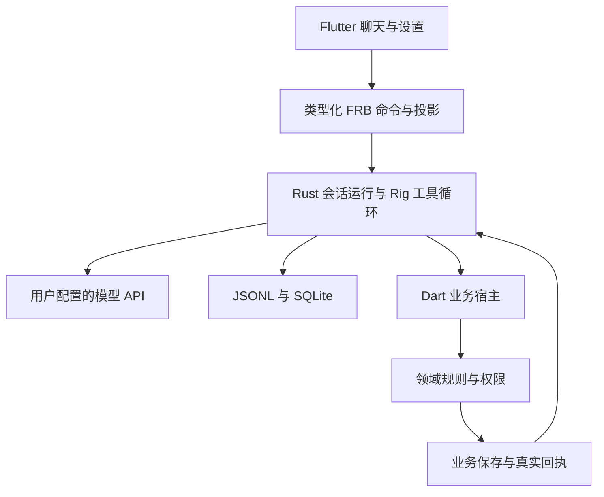

# Agent 架构

Sked 的 Agent 核心使用 Rust、Rig 和 flutter_rust_bridge，在设备本地运行。Flutter 负责界面；Dart 业务宿主继续拥有课表、日程、领域校验、保存、撤销及平台服务。

| 组件 | 职责 |
| --- | --- |
| `AgentApplication` | 组合原生核心、连接、业务工具和应用生命周期 |
| `AgentRustClient` | 共享原生事件流，等待订阅就绪，排空已接纳工作 |
| `RustAgentUiDelegate` | 接入现有聊天动作与逐会话运行状态 |
| `RustConversationRepository` | 缓存列表和分页投影，以明确命令修改原生记录 |
| Rust `RuntimeManager` | 运行、取消、队列、问题、计划、上下文、标题与历史 |
| Rig 与原生 HTTP 层 | 模型协议、工具循环、流式响应和文件上传 |
| `RustAgentBusinessHost` | 绑定运行与工具作用域，返回真实业务结果 |
| `RustAgentOperationInspector` | 只读核对业务与外部操作的已保存回执 |
| `OperationExecutor` | 在一次调用内完成领域编译、权限决定与提交 |
| `RustHistoryMaintenance` | 在各存储逆变更期间持有主库维护租约 |

## 执行与权限

每个会话有一个运行拥有者。页面关闭只释放订阅；停止立即取消尚未接纳的步骤，已接纳的业务保存继续等待真实回执。普通任务没有 Token、轮次、工具次数或时限配额。

模型使用 `mutation.apply`、`settings.update` 等单次业务工具。宿主分配操作身份，记录准备状态后再执行。计划模式返回预览，确认模式显示允许／拒绝，完全权限执行已经请求的动作。工具参数、来源正文与 Skill 内容均不授予权限。

业务主库把变更与 `ApplicationLedger` 回执同次保存；聊天引用对应操作。未知结果先核对原始回执，不重复保存。历史重做先固定并校验整段逆变更，在主库租约内逐拥有者提交；全部逆变更与新历史状态落盘后释放租约，再开始模型重做。中断恢复只完成已接纳的逆变更。

## 数据所有权

| 数据 | 存储 |
| --- | --- |
| 消息、运行、工具结果、队列、摘要、历史版本和绑定 | 每会话追加式 JSONL |
| 会话列表、消息位置与分页索引 | 可重建的 `conversation-index.sqlite` |
| Skills、记忆、内容版本、撤销材料与回执 | `knowledge.sqlite` |
| 文件内容 | 原生私有文件；JSONL 只保存元数据和引用 |
| 连接设置与凭据 | 原有应用设置与系统安全存储 |

未发送会话只在内存中存在。首条消息接纳时，完整初始状态作为一个会话事务写入。正文、附件和上下文引用支持独立更新，省略的字段保持原值。学校网页交接把来源、原始用户消息、轮次与稳定交接标识一起保存；重复导航不重复提交。

页面只读取最近完整消息与工具组，后台执行读取全文不会扩大页面窗口。流式增量用于展示，完整结果结束后保存。来源绑定具体的已接纳输入；显式选择的 Skill 固定正文、版本和工具依赖，排队期间编辑知识不会改变已接纳请求。

## 协议、知识与生命周期

HTTP 传输确认与业务权限分别处理。询问和计划模式等待具体连接确认，完全权限自动放行不生成持久授权。显式同意只复用于相同端点、协议、模型和凭据快照；敏感请求不跟随重定向。标题、压缩和文字重生成经过同一传输入口。

附件先核验私有文件，再原子发布草稿引用。上传按协议从文件分块编码；历史保留私有文件身份，不写入 Base64。知识编辑器只缓存生效记录，提交预期版本，由 Rust 保存变更和回执。

新 Agent 归档由 Rust 编解码，Dart 负责 ZIP、对象选择与原有跨库恢复 journal。恢复的聊天是只读历史，运行、队列和审批不重放。只有全局恢复完成后才结束旧内存草稿。

Windows、Android 提供完整 Agent；其他平台保留普通功能并显示 Agent 暂不可用。实现与验收进度见 [Rust 迁移](AGENT_RUST_MIGRATION.md)，运行细节见 [运行行为](AGENT_RUNTIME.md)、[附件](AGENT_ATTACHMENTS.md)、[知识](AGENT_KNOWLEDGE.md)和[历史](AGENT_HISTORY.md)。
