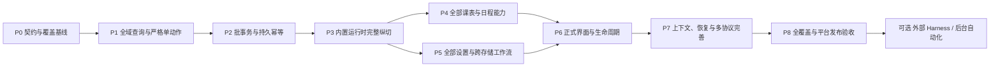

# 全软件 Agent 实施计划

状态：已启动实施，三模式与运行生命周期契约已实现，P0/P1 查询/设置/技能底座进行中。源码研究基线：`ea784f3a16e5d4a23aedae410544492fb6fa0f6f`，2026-10-29，Sked 2.3.0；产品范围与实施启动：2026-10-30。设计与合成表示研究已完成；新增能力按下面的实际进度和验收逐项交付，尚未接通正式 Agent 模型或开放业务写入。

本计划落实[架构提案](AGENT_ARCHITECTURE.md)、[能力全集](AGENT_CAPABILITIES.md)、[数据与应用重构](AGENT_DATA_REFACTOR.md)和[共享 Skills](AGENT_SKILLS.md)，参考[开源 harness 研究](AGENT_HARNESS_RESEARCH.md)。范围为一个内置 Agent、多个会话、自选 API；功能管理开关控制启用/显示，手机采用完整页面；权限仅只读计划、每次修改前询问和完全权限三种。现有独立 AI 解析统一迁入 Agent，按任务封装共享 Skills。

## 1. 总体顺序与交付边界

先使应用能力可稳定编程调用，再接入模型循环；用一条完整链路验证保存、权限和恢复，然后补齐全部领域和配置。首个可演示样例不等于最终能力覆盖。

图中箭头表示阶段验收依赖，不要求所有代码准备工作完全串行。P0/P1 的独立契约和查询可以交叉推进；P4 与 P5 可按文件所有权并行。P3 同时提供可用的手机会话页面和桌面工作台会话界面，P5 只有在双端替代流程可用并通过测试后才切换旧入口，P6 完善正式交互与适配。存储修改、性能采样和全套测试集中协调，避免并行测量污染。各阶段按第 12 节逐原子条目本地提交，不积累到阶段末才做一个大提交。

| 阶段 | 可验收产出 | 依赖 | 完成状态 |
| --- | --- | --- | --- |
| 研究 | 架构、能力、共享 Skills、harness 与计划文档 | 当前源码及公开上游 | 设计完成，未实施 |
| P0 | 契约、能力登记、存储恢复设计验证 | 研究 | 进行中：基础契约与描述目录 |
| P1 | 全量查询及严格单动作 API | P0 | 进行中：六类查询、五类实体严格编译及设置准备已实现；UI适配与实例动作继续推进 |
| P2 | 批量、持久幂等、撤销 | P1 | 进行中：共享写入门禁与 v5 回执/恢复格式已实现，执行与撤销待接入 |
| P3 | 开启 Agent → 新建会话 → Skill/API/工具 → 保存 → 结果 | P2 | 进行中：会话持久化/交接去重完成，模型与双端界面待接入 |
| P4 | 所有课表、课程、日程、重复实例操作 | P3 | 待开始 |
| P5 | 全部设置、旧 AI 退役、网页交接、导入恢复与平台动作 | P3 | 待开始 |
| P6 | 功能管理开关、手机 Agent 页面、多会话与桌面面板 | P4、P5 | 待开始 |
| P7 | 共享技能包完整覆盖、会话恢复、多协议兼容与评测 | P6 | 待开始 |
| P8 | 全能力覆盖、性能与各平台发布证据 | P7 | 待开始 |

### 开工标准与后续门槛

产品范围、平台方向、三种权限、单 Agent 多会话、旧 AI 退役路径、共享 Skills、全软件能力清单、当前源码接入点和验证思路均已明确，足以开始 P0/P1。无需继续扩充 harness 清单或先完成全部重构。P0/P2 中的实现与故障验证是工作内容，不是必须在开始编码前已完成的条件。

| 门槛 | 当前判断 | 尚需完成 |
| --- | --- | --- |
| 开始基础编码 | 已具备条件 | 在首批实现中冻结精确 DTO、错误码、模式/开关默认值、会话持久化和回执结构；这些由工程验证收敛 |
| 开放 Agent 的真实业务写入 | 尚未达到 | 严格命令、模式执行、UI/Agent 写协调、持久幂等、恢复/取消、操作与页面生命周期、端点/凭据边界必须验证 |
| 替换旧 AI 入口并正式发布 | 尚未达到 | 新网页/文字会话闭环、旧数据/密钥迁移、完整能力/Skills、UI和原生平台验收；不能先删掉尚无可用替代流程的入口 |

首批工作按小范围连续交付：

1. **契约与全域读取**：实现 ResourceRef、summary/detail/edit、字段 keep/set/reset、结构化结果及设置描述；用合成数据验证非当前/隐藏/停用域和缺字段语义。
2. **单动作与恢复验证**：先用日程创建/修改/删除作为参考命令，验证同一 operationId 重试、保存后日志失败、UI 并发和恢复换世代；结果用于冻结持久化协议，未过写入门槛前不开放真实 Agent 写入。
3. **手机与桌面会话运行时纵切**：单例设置、多会话、三模式、功能门禁、可控模拟 provider、最小共享 Skills 和操作卡；手机完整页面与桌面工作台界面同时能完成同一场景，再接第一种真实模型协议。桌面不是后续补做或仅布局预览。

初始产品默认值建议在首批实现中采用：旧用户升级不自动开启 Agent，新会话默认每次修改前询问，用户可切换到只读计划或完全权限；不增加第四种模式。这些默认值属于实现细节，不要求另起一轮需求研究。

基础开发和故障验证不依赖真实 API Key。到 P3 真实联调时，再通过应用安全配置选择支持工具调用的测试 API/模型和测试用量范围；不把私人密钥写入文档或聊天。SQLite、Course/Meeting 拆分、稀疏磁盘格式、外部 harness、后台定时和精细 UI 调整均不阻塞首批工作。

## 2. P0：冻结业务契约和覆盖基线

### 实施项

- [ ] 把能力矩阵转为机器可读的 `CapabilityDescriptor` / `SettingDescriptor`；字段包含 scope、schema、操作、存储归属、平台、默认值/reset、结果、授权分类。
- [ ] 建立 FieldSpec 同源约束和独立 AgentProjectionCodec：明确 summary/detail/edit、未返回/null/reset、旧默认解释、查询范围/完整性与 token 计量；不要求先改变磁盘格式。
- [ ] 定义 ResourceRef、OccurrenceRef、CommandEnvelope、PreparedMutation、CommandResult、错误码、数据世代和资源版本规则。
- [ ] 固定三种权限模式及其版本：只读计划不提交；每次修改前询问仅批准当前明确变更；完全权限无应用级逐次审批。不设计额外模式或用户权限档案系统。
- [ ] 固定设置工具为 settings.prepare(action: set/reset) 只返回计划，mutation.commit 才返回生效回执；专用平台/文件工具同样受三模式和操作作用域约束。
- [ ] 完成主库操作回执原子提交的故障验证，选择并冻结下一版 AppData 的操作元数据；不能仅靠聊天日志做幂等。
- [ ] 确定学校站点稳定标识兼容策略、单例 AgentSettings/ModelConnection/Conversation/Run 存储结构、会话隔离和备份恢复边界；无 AgentDefinition/agentId 层级。
- [ ] 定义功能管理 `AgentSettings.enabled` 与手机导航 destination；不混入课表/日程 AppMode 或改变提醒启用计数；冻结正式初值和旧开发者预览开关的迁移边界。
- [ ] 固定共享 Skills manifest/版本/工具依赖/按需发现契约；先覆盖读取安排、新建日程及网页/文字导入技能，再随各领域增加。
- [ ] 按架构第 11 节固定旧 AI 退役清单、压缩页面拆分、来源附件与 handoffId、旧本机连接/密钥迁移和旧备份读取策略。
- [ ] 分离便携备份与本机恢复 journal 编码；恢复操作 ID、源/目标世代在准备阶段固定，重启沿用，便携导出不携带本机执行回执。
- [ ] 列出需从 UI 抽出的校验与副作用，区分纯重构和新增行为；同步受影响行为文档。

### 退出条件

所有当前可配置字段和语义动作都有登记或明确的只读事实分类。协议能表达：隐藏/停用域管理、重复范围、系统结果未知、取消后已提交、写成功但回复丢失、旧备份恢复后运行失效。

必须证明预期的幂等设计能够覆盖“主库存档已替换但会话日志还未记录”这一中断点。若不成立，先修存储协议再开始公开写工具。

建议拆为三个独立变更：能力契约；权限契约；存储协议与迁移验证。此阶段不启用用户界面的模型发送。

## 3. P1：全域查询与严格单动作

### 实施项

- [x] 新建 ResourceQueries：课表/课程、分类/日程、实例、时间集六类查询；明确分页、世代/快照绑定和结果完整性。设置描述与平台状态分别由后续注册表、适配器负责。
- [x] 精确条件先过滤再展开，复用已有日历索引；加入 count/freeSlots/conflicts 聚合和按需字段视图。聚合只展开一次，专项核验来源过滤和结果/候选预算；五时区验收仍在 P8 执行。
- [ ] 查询非当前课表、隐藏分类、停用域不切换 UI，不改变可见性或提醒状态。
- [ ] 从编辑器抽取 CourseDraft、TimetablePatch、PeriodSetDraft、EventPatch 等校验，保留旧时间和旧空周次兼容表示。
- [ ] 抽取 DraftCompiler 及统一 Clock/ID 上下文；字段未出现保持原值，严格新命令不借兼容 normalized 将坏时间修成 now。OperationScope 与 RouteScope 分离，保存结果不依赖 mounted。
- [ ] 明确 create/patch/delete，不接受目标 fallback；新建返回实际 ID，更新和删除检查版本。
- [ ] 扩展命令结果，使 UI 与 Agent 接收相同的持久化结果和错误；先迁移选定 UI 入口，再逐步迁移其余入口。
- [ ] 增加管理停用工作区数据的显式应用命令，与启用/导航命令分开。

### 退出条件

通过合成数据测试，证明两个同名课程、失效分类、非当前课表、隐藏分类均不会改错目标；同一对象被 UI 修改后，旧 API 计划产生冲突并保留草稿。

查询不触发写入，不展开无界重复，不把分页末尾或工具截断误报为数据不存在。读取失败与零结果分别返回。

建议原子拆分：只读查询；课表/课程严格命令；日程/分类严格命令；设置注册表与命令适配。每项包含相关 UI 兼容回归和行为说明。

## 4. P2：批事务、幂等和撤销

### 实施项

- [ ] 增加 prepare / commit 协议：固定目标集合、readSet/writeSet、业务警告、资源版本和计划摘要。
- [ ] 提供 selectionRef + 公共语义 patch，宿主保存完整目标集合；短 ref/游标不采用可变行号，跨数据世代失效，预览能查看全部影响。
- [ ] 同一 AppData 中多项变更由纯 reducers 一次生成候选数据并单次持久化；共享 UI/Agent 写入协调边界。
- [ ] 所有现存主库入口（含延后导航保存、生命周期和维护）纳入读取—变换—提交协调；尚未迁移的入口有可检测的过渡阻塞规则，不允许 Agent 候选覆盖 UI 未落盘数据。
- [ ] 增加与业务变更共同落盘的 operationId/命令摘要/结果回执和数据世代；会话日志可以从该回执修复。
- [ ] 定义有界回执保留和旧请求拒绝规则；相同 ID 不同参数拒绝，过期 ID 不盲重放。
- [ ] 增加对象级逆命令和撤销冲突检查；对删除父资源保存完整关联信息。
- [ ] 恢复/清空从预约开始阻断旧计划，完成后换数据世代；处理维护与 Agent 同时排队的竞争。
- [ ] 数据提交与跨存储/系统 effect 状态分离；未知结果返回可恢复状态。

### 退出条件

失败注入覆盖：准备后对象改变、批中输入非法、写入前取消、落盘失败、主库已提交但会话写入失败、执行进程中断、重启重试和回执过期。不能产生重复创建或静默部分提交。

对同一批量结果连续撤销两次不重复恢复；撤销前人工编辑过对象时不覆盖新编辑。暂存和恢复证据符合既有存储门禁，不能在结果未知时继续写库。

开放写工具前验证旧 UI 命令先更新内存、稍后保存的竞争窗口：Agent 必须等待重读或拒绝提交，不能只依据已提交 revision 宣称无冲突。重启恢复沿用 prepared 阶段的目标数据世代和恢复操作 ID；便携备份与本机 journal 分别验证，避免脱敏导出同时丢失恢复证据。

建议原子拆分：批计划纯逻辑；数据格式/回执迁移；幂等恢复；撤销；维护并发。需要数据格式变更时完整检查备份、旧版拒读和根/嵌套 schema。

## 5. P3：内置运行时的第一条完整链路

### 实施项

- [ ] 实现单例 AgentSettings、统一模型连接和多个 Conversation/Run；新建的是会话，无多个 Agent 身份管理；凭据扩展为安全存储引用。
- [ ] 接入功能管理 Agent 开关的最小执行门禁：关闭隐藏入口、拒绝新请求、取消未提交步骤，保留会话配置并核对已接受写入。
- [ ] 在首个联网写入闭环前接入 AppRuntime 所有权、停止/退出、quiescence 和维护失效；原型面板也不能拥有唯一运行实例。
- [ ] 首个 provider 请求即绑定端点/凭据和有效政策，保留敏感重定向、HTTP 及目的地变更保护；完整配置工作流后续在 P5 扩充。
- [ ] 实现 provider 统一接口，先接通一个 Chat Completions 兼容端点，再用同一场景验证 Responses，避免单协议细节渗透运行时。
- [ ] 实现完整流式工具参数聚合、工具调用/结果事件、限流处理、取消、预算及错误归一化。
- [ ] 模型 token 流和 ConversationViewState 独立发布，不触发 AppData 保存/全日历重建；区分正文代理 token、完整请求计数和实际 usage，记录整任务轮数与重试。
- [ ] 实现仅含三种模式的宿主执行判断；询问确认与完全权限直接执行都绑定真实计划，模型不能自行切模式。
- [ ] 打包并实际加载 `read-agenda`、`find-free-time`、`edit-events` 等最小共享 Skills，验证技能指导能落到工具结果；不只把标题列在 UI。
- [ ] 实现本地 Thread/Run/EventStore 和基本恢复；停止网络后不执行迟到工具。
- [ ] 接入发现能力、查询日程、创建/修改/删除日程、读取/修改一项设置及操作状态查询。
- [ ] 用真实工具卡呈现保存状态和查看对象入口，禁止样例成功内容替代回执。
- [ ] 同时提供可用的基础手机 Agent 页面和桌面工作台会话界面：双端均有会话选择/新建、输入、模型配置、三模式、停止和真实结果。桌面支持与课表/日程并排及窄窗覆盖，沿用窗口/焦点约束；P6 再完善适配。双端界面及网页交接通过前，不退役旧解析入口。
- [ ] 实现运行中会话删除：持久终止标记、停止新/未提交步骤、核对在途业务写入、清理所属正文/附件，迟到结果不得复活会话；最小幂等回执由操作层保留。

### 必须打通的纵向场景

“查看我明天所有安排，避开上课时间在学习分类添加一小时复习，提前十分钟提醒。”

应查询全部课表和相关日程，在已有日历语义下选择时段、使用稳定分类 ID、显示绝对日期、遵守用户授权、创建一次、保存成功后更新 UI 与提醒，并可撤销。网络中断后重试不得多出一条复习事件。

另验证“把刚才那条改到后天”会解析到真实 ID；用户在它执行前已手动改动时返回冲突。只读计划模式给建议但不创建；询问模式在创建及后续改期分别询问；完全权限模式不插入应用级逐次确认。新建第二个会话不复制 Agent，也不混入第一个会话的消息或未完成计划。

### 退出条件

完整闭环在测试 provider 和实际选定测试 endpoint 上分别记录，模型回复与存档状态一致。无工具能力的模型不能显示成可执行 Agent。真实 API 测试使用脱敏数据，记录协议/模型标识和用量，不依赖个人课表。

P3 仅是可用纵切，UI 和文档必须标明尚未覆盖的工具。

最小网络授权、运行所有权和恢复边界必须在本阶段具备；P5/P6 的“整合”指扩充所有设置与正式 UI，不能把首个真实写工具所需的基础约束延后。

## 6. P4：课表与日程全部覆盖

### 实施项

- [ ] 全部课表：创建、详情、配置更新、复制/批量动作、删除、显式导航；更新不隐式切当前课表。
- [ ] 全部课程：字段 patch、移动/复制、时间与节次表示、周次、教师/地点/学分/备注/自定义字段、提醒、名称共享颜色。
- [ ] 时间集：创建、编辑有序节次、引用查询、绑定、重绑后删除，保持一次变更的完整约束。
- [ ] 日历分类：创建、更名、显隐、颜色、顺序、删除及删除最后分类的真实结果。
- [ ] 日程：全部字段、跨分类移动、复制、删除；父资源与子资源版本关系明确。
- [ ] 重复实例：本次、本次及以后、整个系列的编辑和删除；保留月锚点、例外及已处理提醒语义。
- [ ] 跨课表/分类有界冲突查询、批量安排和操作预览；展示冲突选择与真正解决冲突分别建模。
- [ ] 提醒处理/恢复/稍后提醒等已有语义动作完整接入，不发明待办完成状态。
- [ ] 同步封装各能力对应的共享 Skills：课表/课程、作息、冲突、分类、普通/重复日程、提醒和批量修改，包含正常/失败/三模式样例。
- [ ] 按数据工作量补 StudentSnapshot/课程索引，复用未变分支 identity；输入和发布边界深冻结。CourseDefinition/Meeting 或日期模型升级单独决策，不混入本阶段必需操作。

### 退出条件

每类资源完成读取/创建/修改/删除或有依据的替代动作。对旧课表、跨月、跨年、全天、UTC/浮动本地时间、重复次数和例外有专项回归。涉及日期规则的改动按现有 CI 五时区组合验证，Windows 单时区结果不替代它们。

所有修改具备结构化错误、实际 ID、版本前提和可解释结果。隐藏/停用状态保持；提醒只由提交后状态驱动。

建议按课表、课程、时间集、分类、普通事件、重复实例、提醒动作七个能力组拆分，避免在一个大提交中混合所有领域。

## 7. P5：全部设置与跨存储工作流

### 实施项

- [ ] 覆盖 SettingRegistry 全部主库存储偏好，包括两域显示/交互/工具栏/颜色、全局导航、工作区启停、语言和更新选项。
- [ ] 实现 set / patch / reset / unset；区分通知 null 关闭、颜色继承和删除显式覆盖等不同含义。
- [ ] 为设备布局提供正式读写/reset 命令，等待 flush，不复用会冻结存储的清空内部方法。
- [ ] 学校站点采用稳定标识或绑定版本的句柄，统一 UI/Agent 写入队列，覆盖增删改、导入导出和恢复内置。
- [ ] 把凭据更换、端点变化、HTTP 发送范围与权限政策接通；通过安全输入 handle 管理原始密钥。
- [ ] 提取通知配置 workflow：保存、必要系统申请、状态读回和重排分别返回；处理 unsupported/unknown/denied。
- [ ] 为通知/导出副作用返回关联具体数据世代和提交版本的 EffectTicket，区分 pending/applied/superseded/failed/unknown，不读取全局 lastError 代替某次操作结果。
- [ ] 接入文件/文本 JSON、ICS 和节次导入导出，保留大小与模型条数预算、跳过/降级/时区报告和目标确认语义。
- [ ] 拆分 SchoolHtmlImportPage：网页压缩/校对能力保留为来源准备页；删除独立文字 AI 解析入口，文字由普通 Agent 会话处理。保留确定性 JSON 文本/文件、ICS 和节次直导。
- [ ] 来源 SourceAsset、解析 DecodedCandidate 与 PreparedMutation 分离：纯材料解析可独立进行；应用计划才绑定实时业务基线和写权限，不将只读分析绑在原页面或 mutationAllowed 上。
- [ ] 网页准备完成后按 handoffId 创建一次新会话和解析请求，携带不可变来源附件、截断状态和目标上下文，自动加载 `import-school-web`；无需再手动粘贴。未开启/未配置时保留来源并进入统一设置。
- [ ] handoffId、conversationId、初始 message/requestId 和来源引用原子持久化后再启动模型；验证建会话后崩溃、入队后导航失败不会重复执行，同 ID 不同内容或目标拒绝。
- [ ] 区分本地交接去重与远端推理请求结果未知；不承诺任意 provider 的推理/计费 exactly-once，未知请求按实际协议核对，业务重放仍检查持久回执。
- [ ] 退役 SchoolImportParsePage、专用结果编辑路由、SchoolImportParserSettingsPage 和旧专用 AI 网络执行；先迁出 SchoolImportApi 的纯候选解码/预算校验及原页面的预览/日期/作息/目标确认逻辑，再删除无调用代码和翻译。
- [ ] 旧入口切换提交同时包含可用的手机与桌面会话目的地、网页交接/文字输入替代路径和取消/失败/去重回归；不得把任一端替代界面留到后续 P6 才实现。
- [ ] 将旧本机解析连接迁移至统一 Agent 连接；同一端点的旧密钥在新安全存储写入读回成功后退役，失败可恢复；新配置已存在不覆盖。旧 customPrompt 保留一次性迁移材料，不自动变成 Agent 系统指令或 Skill。
- [ ] 更新旧 AiApiSettings 兼容解码、根 schema、备份/journal、清空与启动路径；旧备份字段不覆盖本机 Agent 端点或重新激活旧解析配置，迁移不自动发起推理/开启功能/提升模式。
- [ ] 封装 `import-school-web`、`import-pasted-content`、结构化导入、备份恢复、设置、站点和连接管理共享 Skills，并以真实领域结果验收。
- [ ] 完整备份/恢复/清空通过既有维护协调器和 journal；覆盖主库、站点、凭据、网页会话和新 Agent 数据的清理边界。
- [ ] 覆盖应用已有的平台及开发者语义动作；不可任意改运行时 ledger、同意事实或版本缓存。

### 退出条件

不以“AppData 字段已暴露”宣称全设置完成。独立存储、平台状态、Agent 配置均在覆盖登记中。

验证学校站点并发改 URL/删除不会错位；通知权限拒绝不被包装成成功；Windows 通知权限 unknown 保留真实含义；OEM 自启动仅打开设置页不声称已授权。无 Android 小组件或云同步现成入口的项目标为未有该功能，不能返回假成功。

完全权限模式可直接执行批量删除和完整恢复；询问模式每次具体修改前确认；只读计划模式不写业务状态。任何模式都不接受模型伪造确认。现有交互确认可继续用于人工 UI，底层领域执行不依赖必须存在一个弹窗。

网页交接前取消不创建会话、不发模型请求；交接后返回网页不丢执行所有权。重复点击、网络重试和重启不得重复建会话或导入。输入截断、缺日期/作息、覆盖目标变化都能在会话中校对和重试。旧独立文字/解析设置入口不再存在，也不残留第二条 AI 请求链路；旧存档和备份仍能迁移读取。

## 8. P6：正式产品界面与应用生命周期

### 实施项

- [ ] 功能管理增加 Agent 单开关；手机导航入口随启用显示，关闭时退出 Agent 页面并保留所有会话、草稿、设置和业务数据。
- [ ] 手机正式 Agent 页面：新建会话、会话列表/切换/重命名/删除、聊天与工具结果、输入框、三模式切换；不增加独立 Agent 创建/列表/身份管理页。
- [ ] 连接管理：协议、endpoint、模型、凭据状态、测试连接、修改/删除及引用冲突处理。
- [ ] 正式对话：历史、运行状态、停止、继续、steering/follow-up、操作卡、计划预览、授权选择、撤销和对象跳转。
- [ ] 应用级 Runtime/ThreadController 与面板显示控制分离，接入 AppRuntime、quiescence、维护和退出。
- [ ] 手机采用完整导航页面，桌面助手面板访问同一套会话，尊重已有布局预算；正式开关脱离开发者预览，旧底部导航隐藏偏好下仍有可用的 Agent 导航入口。
- [ ] UI 草稿与 Agent 改同一对象时保留草稿并展示冲突；不同对象可以继续操作。
- [ ] 关闭面板、切工作区、缩放、旋转、输入法和系统返回不丢失会话、不重复发送。
- [ ] 本地化至少英文、简中、繁中；其他语言按贡献指南的显式 fallback 流程处理。

### 退出条件

窄/宽桌面、紧凑触控、2× 字号、RTL、键盘和读屏的输入/停止/确认/结果均可达。覆盖模式不能点击背后的 Agent；隐藏面板移除焦点和语义但保留运行状态。

恢复/清空使旧 run 失效，退出不无限等待模型，已接受的写入结果能核对。手机进入后台/系统终止后恢复不重做已完成步骤。平台模拟和真机结果分别记录。

## 9. P7：上下文、会话恢复与协议完善

### 实施项

- [ ] 工具目录检索与按需加载，只暴露当前已注册并获准使用的能力；schema 数量增加不线性膨胀每轮上下文。
- [ ] 每个会话独立保存历史、摘要、附件和待处理计划；业务状态执行前重读，不建设多个 Agent 的独立记忆体系。
- [ ] 完成共享 Skills 文档中的 24 项任务包及所需附录，每项有 manifest、精确工具依赖、版本兼容、加载事件和可复现样例；任何 Skill 都不自行授予权限。
- [ ] 验证网页入口能定向加载网页导入 Skill，直接粘贴能路由文字导入；复杂任务可组合技能，不把所有完整正文塞入每一轮上下文。
- [ ] 当前步骤 steering 与后续 follow-up 的有序持久队列，校验停止/重启/修改计划时不会执行旧目标。
- [ ] 按 provider 保留所需续传信息，补齐 Responses 与 Chat Completions 的兼容测试；需要原生 Anthropic 协议时通过新适配器接入。
- [ ] 故障恢复区分未开始、已提交、结果未知；任何自动重试先核对领域回执。
- [ ] 消息与审计保留上限、脱敏、导出和显式清除，检查密钥不进入上下文或普通备份。
- [ ] 建立模型任务评测与可复现样例集，测试资料只用稳定合成数据。

### 退出条件

长会话压缩后不遗忘未完成目标、不虚构已执行动作；模型切换/endpoint 变更不会把旧凭据或未经授权的历史发往新目标。工具参数攻击、备注中的伪指令和伪造授权都不能超出宿主权限。

自选 API 的支持范围按已测试协议与能力公开，不能用“兼容 OpenAI”一项布尔值覆盖所有差异。重复模型决策不会绕过业务幂等；真实模型评测不替代确定性安全与持久化测试。

## 10. P8：完成覆盖与发布验证

### 覆盖门禁

- [ ] Capability/Setting registry 与模型序列化字段、实际用户配置入口和 side-store 清单对照；新配置未登记则 CI 失败。
- [ ] 共享 Skill manifest 覆盖所有规定任务，正文/依赖/版本可校验；每项实际加载并通过任务样例，不以技能文件存在代替可执行。
- [ ] 完整任务比较投影、列/行候选和 patch 的总 token、额外查询/重试、正确率；不能将合成文本计数当生产费用。需要紧凑存储时另验版本固定默认、无损展开、strict decode、备份/journal和各平台，保留压缩体积退化等不利结果。
- [ ] 每个 write tool 都有合法输入、无效输入、失效对象、权限、版本冲突、保存失败、取消和实际回执测试。
- [ ] 每个资源能力都有用户可理解的结果、对象跳转或导出产物，不依赖模型自报成功。
- [ ] 每个平台动作明示支持范围和可观测结果；unsupported 不计为该平台已实现。
- [ ] Web 单独验证 CORS、混合内容、安全上下文、流式取消与凭据持久化；不把移动/桌面端自选 API 的结果直接作为浏览器通过，也不自动引入第三方代理。
- [ ] 完整导入/恢复/清空/退出涵盖新增 Agent 状态与凭据；旧版本数据能迁移，较新格式不能被旧逻辑静默覆盖。

### 代表性验收场景

| 场景 | 必须核验的最终状态 |
| --- | --- |
| 查询所有课表、隐藏分类及停用域 | 范围完整、分页可继续，UI 选中与启用状态不变 |
| 统一调整多张课表某些课程 | 固定 ID 集合；任一非法输入不造成半批写入 |
| 调整一个共享节次时间集 | 所有引用课表的时间解析正确，使用中的资源不能直接删除 |
| 每月 31 日系列仅改本次及以后 | 原系列/新系列、月锚点、次数、排除日期和提醒处理状态符合现有规则 |
| 为所有工作区改颜色和工具栏 | 精确颜色/继承语义保持，不切当前工作区、不启用停用域 |
| 用户选择完全权限后批量删除 | 直接执行，无应用级逐次审批；结果和撤销范围完整 |
| 询问模式连续修改两次 | 两次明确变更分别询问；同一次批准不延伸到第二次 |
| 执行前切只读计划或关闭 Agent | 排队业务写入停止，不能使用旧决定继续提交 |
| 从功能管理开启 Agent | 手机显示完整页面入口，可新建多个会话，无多个 Agent 身份层级 |
| 桌面开启并使用 Agent | 会话选择、输入、模式、停止、工具结果均可用；与课表/日程并排和窄窗覆盖保持会话，不止布局预览 |
| 网页压缩校对后继续 | 创建一次新会话、加载网页 Skill 并解析；返回网页后仍可查看运行结果 |
| 直接在会话粘贴课表文字 | 使用共享文字导入 Skill，不打开旧独立解析页 |
| 更换会话后继续 | 共享同一工具与 Skill 包，历史/附件/未提交计划不串会话 |
| 删除正在执行的会话 | 未提交步骤停止、在途写入可核对、正文与所属附件清理，迟到响应和重启不复活会话 |
| 写入成功后网络/会话日志失败 | 重试返回原操作结果，不重复创建 |
| 执行中恢复备份 | 旧运行/计划失效，不用旧 ID 写入恢复后的数据 |
| 开启通知但系统拒绝 | App 偏好保存状态和权限拒绝分别显示，不声称已投递 |
| 替换模型 endpoint | 权限与凭据目的地重新核验，不向新服务盲发旧历史 |
| 关闭 Agent 面板并重启 | 历史、已提交结果和待处理状态可核对，不隐式重放 |

### 检查与证据

先运行针对性测试，再按[贡献指南](../CONTRIBUTING.md)执行格式、分析、完整 VM 测试和适用平台门禁。模型协议、状态机和故障测试使用确定性 fake provider；真实模型测试独立记录，不依赖外部模型每次给出同样回复。

性能验证先保存稳定源码/数据/协议的基线，在独占窗口测量：不开 Agent 的启动和内存、打开对话的内存、长会话分页、查询所有课表的耗时、工具目录开销、批量保存与 UI 帧。建议验收目标包括不开 Agent 不加载网络会话、不全量解码聊天；具体预算在 P0/P1 取得基线后冻结，不能凭空声称零开销。

每轮记录源码 SHA、命令、平台、真实范围及失败，临时日志/脚本/截图在系统临时目录，本地执行遵守已确定的 F 盘临时目录约定。真机通知/后台行为、Windows 原生能力、模拟器和 Widget 测试分别记录；不把云 CI 或截图替代物理设备验收。

## 11. 后续可选扩展

以下不是首期全软件工具覆盖的前置条件，也不能用它们延期当前必需资源的 CRUD：

- **外部 Agent 接入**：以同一工具注册表生成 MCP 或受认证 RPC，先验证桌面本地连接；随后可增加 Codex app-server、pi 或 DeepSeek adapter。
- **后台与定时 Agent**：单独设计平台调度、授权有效期、预算、设备在线和错过执行的行为；移动端系统限制不通过永久循环解决。
- **新增业务领域**：独立 Todo、标签、云同步、小组件等当前不存在的功能先有自己的模型和业务设计，再自动进入能力注册流程。
- **可执行插件**：需要版本、来源、运行隔离和权限策略；首期文本 Skills 和内置工具已能覆盖现有软件。

## 12. 执行纪律与下一步

### 原子化本地提交是实施要求

用户已明确要求本计划实施采用原子化提交。进入实施后，每个完成并通过适用检查的独立条目都应形成一个本地提交，再继续依赖它的后续条目；不把整个 P 阶段、全部 Agent 功能或若干无关修复攒成一个大提交。无需为每个符合此范围的本地提交重复询问。推送、改写远端历史、发布和商店提交仍是单独动作，不能由本地提交要求推导授权。

每个提交必须同时满足：

1. **一个明确问题或能力。** 有清楚的行为变化和边界，不混入无关清理、格式化、依赖升级或他人修改。原子单位按功能依赖划分，不按文件数量机械切碎。
2. **当前提交独立完整。** 在其父提交基础上能编译并通过相关检查；不能先提交会编译失败的接口，指望下一条再补调用者，也不提交占位成功或禁用断言来过门禁。
3. **必要证据同提交。** 实现、证明行为的回归、受影响公开说明一起交付；新增工具的注册/schema/模式行为和对应 Skill/manifest/必要资产声明同步，或先保持该未完成能力不公开。ARB 与生成本地化文件始终同提交。
4. **迁移成套交付。** 格式版本、writer/reader、严格校验、迁移、受影响调用者及兼容/恢复测试属于完整单元。密钥目的地绑定、写入读回、失败恢复与旧 key 退役不能拆成先删旧值再补保护。
5. **可评审与可回退。** 纯代码重构先证明旧行为保持，再单独提交新增行为；涉及数据格式时记录恢复/降级边界，Git revert 不等于用户数据已回滚，旧版本不能覆盖新格式。

### 每条提交的执行流程

1. 开始前核对分支、HEAD、索引、工作区和并行任务，确定本条文件或 diff 区块的所有权。遇到同文件无关改动，按区块精确暂存；不能使用全仓 `git add -A` 混入其他工作，也不覆盖或清空他人修改。
2. 实现一个条目，运行其必要回归与贡献指南要求的适用格式/分析/平台检查。确保被测源码与拟提交内容一致；工作区有其他改动影响验证时，用干净工作树或系统临时副本验证该提交内容。
3. 检查 `git diff --staged`、`git diff --cached --check` 和暂存文件清单，确认不含临时工件、凭据、无关文件或被忽略的内部计划；不使用 `git add -f` 强行加入。
4. 使用自己的 Git 身份和已配置的 **SSH 签名**创建提交，消息为单行中文 `type(范围): 摘要`，例如 `feat(Agent): 添加日程摘要查询`。随后运行 `git verify-commit HEAD`，核对提交内容和剩余工作区。签名或验签失败不降级为无签名完成。
5. 记录源码 SHA、运行命令、平台、实际测试范围和遗留项，同步本计划及受影响行为说明，再推进依赖条目。结果日志与一次性回执放系统临时目录；长期行为与协议放公开文档，不把历史测试转述成新提交通过。

计划状态的勾选与行为说明应随对应实现提交更新；验签后得到的 SHA 可写入临时/本地交接记录，阶段结束时再把需要长期保留的提交索引整理进适当公开记录。不要为向同一提交写入自己的 SHA 反复 amend。

### 各阶段的建议提交粒度

| 阶段 | 原子拆分方向 | 必须一起完成的边界 |
| --- | --- | --- |
| 规划基线 | 相关设计文档及导航引用可独立成为一个文档提交 | 链接可访问、当前行为/未实现设计明确；同文件无关区块排除 |
| P0/P1 | 公共契约、查询投影、某领域草稿编译、对应 UI 适配分别交付 | 接口与受影响调用者及必要回归完整，纯抽取不夹带行为变化 |
| P2 | 操作元数据迁移、写协调、批计划/幂等执行、撤销按可运行单元拆分 | 每次 schema 改动的读写/迁移/恢复成套；不以小提交名义制造不可读中间存档 |
| P3 | 会话存储、三模式、provider 适配、Skill 加载、基础会话页面分组交付 | 每组可测试，首次公开写能力前所需约束全部具备 |
| P4/P5 | 按课表/课程/时间集/分类/重复实例/设置/站点等能力组拆分 | 工具、注册、对应 Skill、测试与文档保持一致；24 项 Skills 随能力逐组交付 |
| 旧 AI 迁移 | 纯准备/decoder 抽取、完整配置迁移、新入口切换、无调用旧代码清理分开 | 切换入口时替代流程已可用；旧密钥删除不能早于成功迁移和读回 |
| P6/P7 | 页面/会话交互、上下文/计量优化、技能补齐按问题拆分 | 每项有真实行为与必要平台/无障碍/协议验证，不以静态样例替代执行 |
| P8 | 根据验收发现逐问题修复 | 修复与复现回归同提交；全套与平台门禁完成后才报告阶段验收 |

并行工作按文件与能力归属分配，在依赖合入顺序上收口；已经承诺给下一条的接口以实际本地提交为基线。阶段门禁失败时先解决具体问题，通过受影响检查后提交独立修复，再重跑必要阶段门禁；不堆积后续条目掩盖失败，也不把整段历史 squash 成失去原子边界的大提交。

下一步从 **P0 的能力契约与存储恢复设计验证** 开始，同时准备 P1 查询 DTO。首个产品闭环按 P3 场景验证。完成每个阶段后更新本计划的实际状态、能力覆盖表和当前行为文档，再推进后续阶段；未验证项保持待验状态。
