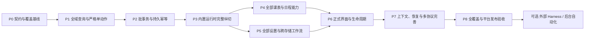

# 全软件 Agent 实施计划

状态：P0–P7 的首期能力实现与确定性专项已接通，2026-10-31 按用户确认的新方向恢复实施，P8 尚未完成。已有 Agent 分支已快进合入 `main`，后续直接在 `main` 开发。源码研究基线：`ea784f3a16e5d4a23aedae410544492fb6fa0f6f`，首轮收尾基线：`8cd92239060807cd624772de355ca7543d0a3a51`；两者均不代表后续改动已验收。真实 API 首轮仍有超时及请求预算失败；完整成本、独占性能采样、最终平台门禁及实体设备验收保持待完成。

下列 `[x]` 表示对应实现和确定性专项回归已具备，不代表阶段退出条件、真实模型或设备验收全部通过。标准资源/设置的对象依赖、持久运行用量以及按提交核对的通知票据已补齐；宿主 draft/撤销的进一步并发细化、全部旧 UI 的 typed 返回迁移、真实模型成本对照和按测量决定的 StudentSnapshot 优化仍分别评估。

专项证据入口包括[应用组合与技能装载](../test/agent/agent_application_test.dart)、[运行时及 HTTP 权限](../test/agent/runtime/agent_runtime_controller_test.dart)、[宿主回执恢复](../test/agent/runtime/operation_recovery_test.dart)、[外部操作协调](../test/application/external_operation_coordinator_test.dart)和[冲突显示/日期范围适配](../test/agent/tools/display_range_tool_adapters_test.dart)。这些入口用于定位可复现覆盖，不代替最终源码上的完整门禁。

本计划落实[架构提案](AGENT_ARCHITECTURE.md)、[能力全集](AGENT_CAPABILITIES.md)、[数据与应用重构](AGENT_DATA_REFACTOR.md)和[共享 Skills](AGENT_SKILLS.md)，参考[开源 harness 研究](AGENT_HARNESS_RESEARCH.md)。范围始终为一个内置 Agent、多个会话、单个自选 API；权限仅只读计划、每次修改前询问和完全权限三种。下列修订覆盖旧方案中的默认关闭、单模型、只读内置 Skills、暂不提供长期记忆和整体备份等设计；未完成修订前，行为文档仍记录实际实现。

## 本次完善：用户已确认的交付方向

所有实现直接落在 `main`，逐问题 SSH 签名本地提交并验签，不新建开发分支。保留原 P0–P7 已有成果，重新打开 P2/P5/P6/P7 中受影响的能力，P8 欠项继续验收。

| 阶段 | 交付与退出条件 | 状态 |
| --- | --- | --- |
| R0 合入与契约 | 原 Agent 提交快进合入 main；实施方向与迁移边界可追溯 | 已合入；本节维护实施进度 |
| R1 设置与聊天 | 独立 Agent 设置；一次性默认开启；单 API 多模型及思考档位；手机、完整桌面与面板共享真实会话；M3 Expressive | 独立设置、按需初始化、多模型和双端聊天已接通；最终平台交互由 R6 验收 |
| R2 文件 | 任意类型选择、二进制持久化、原生协议发送、取消/失败重试、刷新与重启恢复 | 二进制仓储、消息引用、原生协议发送及取消/恢复已接通；真实平台和模型由 R6 验收 |
| R3 共享知识 | 用户与 Agent 共用 Skills/记忆 CRUD、内置覆盖、版本冲突、条件逆操作及恢复 | 共享仓储、正式设置、工具与条件逆操作已接通；真实任务质量由 R6 验收 |
| R4 历史重做 | 消息版本、完整轮次归属、整段撤销预检、跨存储恢复、重做中断继续 | 会话 v5、正式聊天入口、完整轮次归属、跨库中断恢复及继续已接通；真实模型与设备由 R6 验收 |
| R5 可选备份 | 对象选择、依赖清单、未选保留、跨存储恢复和二进制附件 | 归档、规划和各仓储恢复已接入应用生命周期并完成独立故障回归；Agent 工具与设置界面随后分别接入 |
| R6 最终验收 | 新能力与原 P8 的真实任务、成本、性能、各平台及无障碍证据 | 待验收 |

### 产品行为与实现约束

- 设置主页和聊天直接进入独立 Agent 设置；功能管理仅控制开关。新装默认开启，升级进行一次前向开启迁移；之后用户关闭以及旧便携备份恢复均不重新触发。开启不自动联网。
- 单 API 下可搜索、多选或手填模型并设置默认；每个模型配置可选思考档位。自动档位不发送参数。共享连接、模型目录、会话选择和发送/入队时的请求快照分开；一个请求内全部工具循环固定配置，旧模型专属续传数据不跨模型复用。
- 手机完整聊天页、桌面工作台与侧面板共用会话/草稿/运行。正文 Markdown、代码复制、输入区及运行结果均接通真实能力；流式回复不抢阅读和输入焦点。M3 Expressive 组件、形状、状态和动效贯穿新界面，并尊重减少动态效果。
- Skills 可创建、修改、启停；内置发布原版保留，修改形成覆盖，恢复原版只清除覆盖、不改变启停。共享记忆允许 Agent 在正常会话中主动维护，沿用三种权限，不增加后台自动化。知识仓储拥有正文、版本及逆操作，公共回执只引用；旧记忆不替代实时业务数据。
- 文件选择不限制扩展名，按所选 API 原生能力发送，不增加 OCR/转码/抽帧。支持仅附件消息；原生私有文件与 Web IndexedDB 保存二进制，聊天只存引用。编码前检查实际预算并接入取消；选择、本地保存、发送与服务接受是不同状态。不可发送时保留附件并给出真实原因，不自动换模型或只发文件名。
- 重新生成回复不写业务。编辑并重做撤销所选完整轮次及之后本会话的 Agent 操作；不回滚手动编辑和其他会话。全部逆变更预检后才开始；不可逆、冲突、缺回执或超预算整次不开始，由用户取消或另选保留现状修正。撤销后只重做选中请求，后续旧消息保留历史、旧审批和队列失效；重做失败保留进度，继续不重复撤销。
- 可选备份细到课表、分类、站点、Skill、记忆和聊天；设置按组、聊天附件独立勾选。同 ID 选中对象替换原位置，不存在则新增，同名不自动合并；未选对象保留，空分组不清空整类。依赖冲突只复制并重绑所选对象；直接替换共享资源影响未选引用者时要求补选或取消。
- 新备份为版本化清单及文件归档，旧 JSON 进入同一选择恢复。密钥、Cookie、系统授权与运行许可不导出；恢复聊天仅恢复历史。恢复使用独立静止边界排空侧写，固定目标/映射后记录各仓储阶段，重启继续同一目标，Agent 发起者不等待自身造成死锁。

每个阶段同时交付调用链、迁移/严格读取、必要故障回归、界面和行为说明。性能采样独占；历史模拟、真实 API 和实体设备结果分别记录。旧节次保留的勾选表示首期实现，不能替代本表的新交付。

## 1. 总体顺序与交付边界

先使应用能力可稳定编程调用，再接入模型循环；用一条完整链路验证保存、权限和恢复，然后补齐全部领域和配置。首个可演示样例不等于最终能力覆盖。

图中箭头表示阶段验收依赖，不要求所有代码准备工作完全串行。P0/P1 的独立契约和查询可以交叉推进；P4 与 P5 可按文件所有权并行。P3 同时提供可用的手机会话页面和桌面工作台会话界面，P5 只有在双端替代流程可用并通过测试后才切换旧入口，P6 完善正式交互与适配。存储修改、性能采样和全套测试集中协调，避免并行测量污染。各阶段按第 12 节逐原子条目本地提交，不积累到阶段末才做一个大提交。

| 阶段 | 可验收产出 | 依赖 | 完成状态 |
| --- | --- | --- | --- |
| 研究 | 架构、能力、共享 Skills、harness 与计划文档 | 当前源码及公开上游 | 设计完成 |
| P0 | 契约、能力登记、存储恢复设计验证 | 研究 | 当前实现契约、字段登记与实际工具覆盖专项已通过 |
| P1 | 全量查询及严格单动作 API | P0 | 六类查询、严格实体/重复实例命令、设置准备已实现 |
| P2 | 批量、持久幂等、撤销 | P1 | 原子主库提交、固定目标、跨重启回执、条件撤销及外部队列取消已实现 |
| P3 | 开启 Agent → 新建会话 → Skill/API/工具 → 保存 → 结果 | P2 | 本地确定性闭环已接通；真实选定端点联调另验 |
| P4 | 所有课表、课程、日程、重复实例操作 | P3 | 资源、重复范围、提醒处理和真实冲突显示选择已接入并通过专项 |
| P5 | 全部设置、旧 AI 退役、网页交接、导入恢复与平台动作 | P3 | 文件、连接、站点、设备、维护、旧入口替换及自定义日期范围已接入并通过专项 |
| P6 | 功能管理开关、手机 Agent 页面、多会话与桌面面板 | P4、P5 | 手机独立页面及桌面并排/覆盖共用会话；归档、附件、审批和操作卡已接入 |
| P7 | 共享技能包完整覆盖、会话恢复、多协议兼容与评测 | P6 | 双协议、24 技能、输入队列、有界上下文及宿主回执恢复已实现；真实模型质量和成本另验 |
| P8 | 全能力覆盖、性能与各平台发布证据 | P7 | 本轮收尾后暂停；真实模型任务仍有失败，完整成本/性能和平台发布验收待完成 |

### 实施依据与后续门槛

产品范围、平台方向、三种权限、单 Agent 多会话、旧 AI 退役路径、共享 Skills、全软件能力清单、当前源码接入点和验证思路均已明确，足以开始 P0/P1。无需继续扩充 harness 清单或先完成全部重构。P0/P2 中的实现与故障验证是工作内容，不是必须在开始编码前已完成的条件。

| 门槛 | 当前判断 | 尚需完成 |
| --- | --- | --- |
| 开始基础编码 | 已完成相应实施 | 当前契约、模式/开关默认值、会话持久化和回执结构已有实现及故障回归 |
| Agent 提交真实业务数据 | 确定性闭环及部分真实 API 任务已有终态核验 | 严格命令、权限、写协调、幂等和恢复已有专项；选定真实 API 仍有超时、纠错成本和请求预算失败，不算全任务验收通过 |
| 旧入口替换 | 双端替代及迁移已实现 | 网页/文字会话、旧连接/密钥迁移和取消/失败/去重已有回归；原子提交边界由最终分组核对 |
| 正式发布 | 尚未达到 | 浏览器的隔离协议/存储验证只覆盖已测环境；完整 VM、最终平台、性能及原生设备门禁分别完成后再确认 |

已采用的基础交付顺序保留如下，供后续维护理解依赖：

1. **契约与全域读取**：实现 ResourceRef、summary/detail/edit、字段 keep/set/reset、结构化结果及设置描述；用合成数据验证非当前/隐藏/停用域和缺字段语义。
2. **单动作与恢复验证**：先用日程创建/修改/删除作为参考命令，验证同一 operationId 重试、保存后日志失败、UI 并发和恢复换世代；结果用于冻结持久化协议，未过写入门槛前不开放真实 Agent 写入。
3. **手机与桌面会话运行时纵切**：单例设置、多会话、三模式、功能门禁、可控模拟 provider、最小共享 Skills 和操作卡；手机完整页面与桌面工作台界面同时能完成同一场景，再接第一种真实模型协议。桌面不是后续补做或仅布局预览。

AppData 版本 6 新装及本机升级进行一次入口开启，之后保存用户开关选择；普通备份恢复保留接收设备的选择。默认每次修改前询问，用户可切换到只读计划或完全权限；不增加第四种模式。

基础开发和故障验证不依赖真实 API Key。到 P3 真实联调时，再通过应用安全配置选择支持工具调用的测试 API/模型和测试用量范围；不把私人密钥写入文档或聊天。SQLite、Course/Meeting 拆分、稀疏磁盘格式、外部 harness、后台定时和精细 UI 调整均不阻塞首批工作。

## 2. P0：冻结业务契约和覆盖基线

### 实施项

- [x] 能力矩阵由实际工具注册表和 `SettingRegistry` 承担机器可读登记，包含 schema、操作、存储归属、平台、默认值/reset 和授权分类；未要求统一采用提案中的 `CapabilityDescriptor` 类名。
- [x] `ResourceMutationSchema` 与编译器白名单同源，`ResourceQueries` 提供 summary/detail/edit 投影，设置描述定义未返回/null/reset、兼容默认和范围/完整性；分别承担提案 FieldSpec/AgentProjectionCodec 的职责，不改磁盘格式。完整任务 token 评测归入 P8。
- [x] 定义 ResourceRef、OccurrenceRef、严格资源命令、PreparedMutation、持久操作结果、错误码和数据世代；标准资源/设置按对象及语义依赖校验，宿主 draft/待提交撤销等保留整快照后备门禁。
- [x] 固定三种权限模式及其版本：只读计划不提交；每次修改前询问仅批准当前明确变更；完全权限无应用级逐次审批。不设计额外模式或用户权限档案系统。
- [x] 固定设置工具为 settings.prepare(action: set/reset) 只返回计划，mutation.commit 才返回生效回执；专用平台/文件工具同样受三模式和操作作用域约束。
- [x] 完成主库操作回执原子提交故障验证，AppData 顶层 schema 5 保存有界操作账本；幂等不依赖聊天日志。
- [x] 确定学校站点版本句柄、单例 AgentSettings/统一连接/Conversation/Run 存储结构、会话隔离和备份恢复边界；无 AgentDefinition/agentId 层级。
- [x] 定义功能管理 `AgentSettings.enabled` 与手机导航 destination；不混入课表/日程 AppMode 或改变提醒启用计数；正式初值和旧开发者预览开关迁移已有回归。
- [x] 固定共享 Skills manifest、版本、工具依赖和按需发现契约，并完成各领域任务包接入。
- [x] 落实旧 AI 退役清单、压缩页面拆分、来源附件与 handoffId、旧本机连接/密钥迁移和旧备份读取策略。
- [x] 分离便携备份与本机恢复 journal 编码；恢复目标及目标世代在实际恢复写入 journal 时固定，重启沿用，便携导出不携带本机执行回执。
- [x] 抽出本期工具所需的纯校验与服务变换，保留 UI 的持久化和副作用所有权，并同步行为说明。

### 退出条件

所有当前可配置字段和语义动作都有登记或明确的只读事实分类。协议能表达：隐藏/停用域管理、重复范围、系统结果未知、取消后已提交、写成功但回复丢失、旧备份恢复后运行失效。

必须证明预期的幂等设计能够覆盖“主库存档已替换但会话日志还未记录”这一中断点。若不成立，先修存储协议再开始公开写工具。

建议拆为三个独立变更：能力契约；权限契约；存储协议与迁移验证。此阶段不启用用户界面的模型发送。

## 3. P1：全域查询与严格单动作

### 实施项

- [x] 新建 ResourceQueries：课表/课程、分类/日程、实例、时间集六类查询；明确分页、世代/快照绑定和结果完整性。设置描述与平台状态分别由后续注册表、适配器负责。
- [x] 精确条件先过滤再展开，复用已有日历索引；加入 count/freeSlots/conflicts 聚合和按需字段视图。聚合只展开一次，专项核验来源过滤和结果/候选预算；五时区验收仍在 P8 执行。
- [x] 查询非当前课表、隐藏分类、停用域不切换 UI，不改变可见性或提醒状态。
- [x] 通过严格资源命令编译器和现有纯服务验证课程、课表、节次集与日程输入，保留旧时间和旧空周次兼容表示；未强制采用提案草稿类名。
- [x] 统一 MutationContext 的 Clock/ID；字段未出现保持原值，严格新命令不借兼容 normalized 将坏时间修成 now。OperationScope 与页面生命周期分离，保存结果不依赖 mounted。
- [x] 明确 create/patch/delete，不接受目标 fallback；新建返回实际 ID，更新和删除检查准备时的版本。
- [x] 严格管理接口复用纯服务及 AppSession 边界，提供结构化持久结果，并通过旧 UI 兼容回归。
- [ ] 将所有旧 UI commands 进一步迁为统一 typed 返回契约。当前保留既有 UI commands，不把服务复用和共享提交边界称为全 UI 返回契约迁移。
- [x] 增加管理停用工作区数据的显式应用命令，与启用/导航命令分开。

### 退出条件

通过合成数据测试，证明两个同名课程、失效分类、非当前课表、隐藏分类均不会改错目标；同一对象被 UI 修改后，旧 API 计划产生冲突并保留草稿。

查询不触发写入，不展开无界重复，不把分页末尾或工具截断误报为数据不存在。读取失败与零结果分别返回。

建议原子拆分：只读查询；课表/课程严格命令；日程/分类严格命令；设置注册表与命令适配。每项包含相关 UI 兼容回归和行为说明。

## 4. P2：批事务、幂等和撤销

### 实施项

- [x] 增加 prepare / commit 协议：固定目标集合、业务变化和计划摘要，始终核对数据世代、运行授权与未保存草稿。
- [x] 标准资源与设置命令固定 ID/时钟和对象/语义读取依赖，在当前已保存快照重编译并核对完整审批差异，保留无关已保存编辑；同对象和共享节次等依赖变化拒绝提交。
- [ ] 按实际需要继续细化宿主 prepareDraft、待提交撤销及跨 Agent 回执序列的并发依赖；这些路径仍要求较保守的重新准备，不声称所有计划均已对象级合并。
- [x] 提供 selectionRef + 公共语义 patch，宿主保存完整目标集合；短 ref/游标不采用可变行号，跨数据世代失效，预览能查看全部影响。固定集合、跨页完整性、运行/快照绑定及超额拒绝已接入正式工具。
- [x] 同一 AppData 中多项变更由纯 reducers 一次生成候选数据并单次持久化；共享 UI/Agent 写入协调边界。
- [x] 主库提交、延后导航保存、生命周期和维护通过 AppSession/运行时协调；旧 UI 未落盘状态由 dirty/epoch 过渡门禁检测，Agent 等待重读或拒绝，不能覆盖其草稿。
- [x] operationId、命令摘要、结果回执和数据世代与业务变更共同落盘；会话结果可以从该回执恢复。
- [x] 有界回执保留和旧请求拒绝：相同 ID 不同参数拒绝，过期 ID 不盲重放。
- [x] 对象级逆命令检查撤销冲突，删除父资源保留完整关联信息；逆变更共用三模式和版本门禁，重复撤销跨重启返回原逆操作回执，并接入操作卡。
- [x] 恢复/清空从预约开始阻断旧计划，完成后换数据世代；宿主维护已接线。外部队列可取消尚未开始的提交/核对，避免维护等待自身后续队列；已接受操作继续核对。
- [x] 数据提交与跨存储/系统 effect 状态分离；外部协调器及宿主适配已验证先记录后执行、原请求重试、只读核对、回执保存失败和世代变化，未知结果保留可恢复状态。

### 退出条件

失败注入覆盖：准备后对象改变、批中输入非法、写入前取消、落盘失败、主库已提交但会话写入失败、执行进程中断、重启重试和回执过期。不能产生重复创建或静默部分提交。

对同一批量结果连续撤销两次不重复恢复；撤销前人工编辑过对象时不覆盖新编辑。暂存和恢复证据符合既有存储门禁，不能在结果未知时继续写库。

开放写工具前验证旧 UI 命令先更新内存、稍后保存的竞争窗口：Agent 必须等待重读或拒绝提交，不能只依据已提交 revision 宣称无冲突。重启恢复沿用恢复开始时写入 journal 的目标数据世代和恢复身份；便携备份与本机 journal 分别验证，避免脱敏导出同时丢失恢复证据。

建议原子拆分：批计划纯逻辑；数据格式/回执迁移；幂等恢复；撤销；维护并发。需要数据格式变更时完整检查备份、旧版拒读和根/嵌套 schema。

## 5. P3：内置运行时的第一条完整链路

### 实施项

- [x] 单例 AgentSettings、统一模型连接和多个 Conversation/Run；新建的是会话，无多个 Agent 身份管理；凭据使用安全存储引用。
- [x] 功能管理 Agent 开关控制执行门禁：关闭隐藏入口、拒绝新请求、取消未提交步骤，保留会话配置并核对已接受写入。
- [x] AppRuntime 拥有唯一应用级执行器，接入停止/退出、quiescence 和维护失效；面板不拥有运行生命周期。
- [x] provider 请求绑定端点/凭据和有效政策，保留敏感重定向、HTTP 及目的地变更保护，并接通 P5 配置工作流。
- [x] provider 统一接口和 Chat Completions / Responses 两种兼容实现通过确定性协议场景；真实选定端点已有合成任务联调，失败与实际终态独立记录，不据此推导双协议在任意服务均可用。
- [x] 完整流式工具参数聚合、工具调用/结果事件、限流处理、取消、预算及错误归一化。
- [x] 模型 token 流和会话视图独立发布，不触发 AppData 保存；usage 与轮次用于运行预算及停止判断。
- [x] 会话 v2 按运行/请求保存实际 usage、工具尝试、显式继续关系和未知结果；重复流式统计不重复计数，查询和导出可核对，缺失用量/费用保持未知，旧会话兼容读取。
- [ ] 完整真实任务的表示、重试、正确率及成本对照；已有持久使用量不能单独证明费用改善。
- [x] 宿主仅执行三种模式；询问确认与完全权限直接执行绑定真实计划，模型不能自行切模式。
- [x] 打包并实际加载 `read-agenda`、`find-free-time`、`edit-events` 等共享 Skills，校验工具依赖并接入真实领域工具。
- [x] 本地会话/运行/事件持久化和基本恢复；停止网络后不执行迟到工具。
- [x] 接入能力发现、日程查询及增删改、设置读取/修改和操作状态查询。
- [x] 工具卡使用真实回执呈现保存状态和查看对象入口。
- [x] 手机 Agent 页面和桌面工作台均提供会话选择/新建、输入、模型配置、三模式、停止及真实结果；桌面并排/窄窗覆盖沿用布局与焦点约束，双端替代和网页交接已有回归。
- [x] 运行中会话删除持久终止其身份，停止新/未提交步骤，核对在途业务写入并清理正文/附件；迟到结果不复活会话，最小幂等回执由操作层保留。

### 必须打通的纵向场景

“查看我明天所有安排，避开上课时间在学习分类添加一小时复习，提前十分钟提醒。”

应查询全部课表和相关日程，在已有日历语义下选择时段、使用稳定分类 ID、显示绝对日期、遵守用户授权、创建一次、保存成功后更新 UI 与提醒，并可撤销。网络中断后重试不得多出一条复习事件。

另验证“把刚才那条改到后天”会解析到真实 ID；用户在它执行前已手动改动时返回冲突。只读计划模式给建议但不创建；询问模式在创建及后续改期分别询问；完全权限模式不插入应用级逐次确认。新建第二个会话不复制 Agent，也不混入第一个会话的消息或未完成计划。

### 退出条件

完整闭环在测试 provider 和实际选定测试 endpoint 上分别记录，模型回复与存档状态一致。无工具能力的模型不能显示成可执行 Agent。真实 API 测试使用脱敏数据，记录协议/模型标识和用量，不依赖个人课表。

P3 的确定性纵切已通过；真实选定 endpoint 已观测到业务保存、最终回复及用量一致的任务，也有保存后最终回复超时等未完成任务。结果及用量按实际冻结源码独立记录，不能从 fake provider 或工具测试推断。

最小网络授权、运行所有权和恢复边界必须在本阶段具备；P5/P6 的“整合”指扩充所有设置与正式 UI，不能把首个真实写工具所需的基础约束延后。

## 6. P4：课表与日程全部覆盖

### 实施项

- [x] 全部课表：创建、详情、配置更新、复制/批量动作、删除、显式导航；更新不隐式切当前课表。
- [x] 全部课程：字段 patch、移动/复制、时间与节次表示、周次、教师/地点/学分/备注/自定义字段、提醒、名称共享颜色。
- [x] 时间集：创建、编辑有序节次、引用查询、绑定、重绑后删除，保持一次变更的完整约束。
- [x] 日历分类：创建、更名、显隐、颜色、顺序、删除及删除最后分类的真实结果。
- [x] 日程：全部字段、跨分类移动、复制和删除；父子引用经过严格校验，标准计划提交时核对对象和语义依赖。
- [x] 重复实例：本次、本次及以后、整个系列的编辑和删除；保留月锚点、例外及已处理提醒语义。
- [x] 跨课表/分类有界冲突查询、固定批量安排和操作预览；展示选择与真正修改时间解决冲突分开。
- [x] `courses.display.list/prepare` 复用指定周的实际完整冲突投影，校验可选课程；旧格式选择可重置，非本周预览不能代替本周课程。支持非当前及停用课表，经 `mutation.commit` 保存并撤销。
- [x] 提醒处理/恢复/稍后提醒等已有语义动作接入，不发明待办完成状态。
- [x] 对应共享 Skills 已封装课表/课程、作息、冲突、分类、普通/重复日程、提醒和批量修改，并校验实际工具依赖；真实模型逐任务质量另验。
- [ ] 按稳定测量结果决定是否进一步增加 StudentSnapshot/课程索引及分支复用；不把此优化视为当前 CRUD 功能缺失。CourseDefinition/Meeting 或日期模型升级单独决策，不混入必需操作收尾。

### 退出条件

每类资源完成读取/创建/修改/删除或有依据的替代动作。对旧课表、跨月、跨年、全天、UTC/浮动本地时间、重复次数和例外有专项回归。涉及日期规则的改动按现有 CI 五时区组合验证，Windows 单时区结果不替代它们。

所有修改具备结构化错误、实际 ID、版本前提和可解释结果。隐藏/停用状态保持；提醒只由提交后状态驱动。

建议按课表、课程、时间集、分类、普通事件、重复实例、提醒动作七个能力组拆分，避免在一个大提交中混合所有领域。

## 7. P5：全部设置与跨存储工作流

### 实施项

- [x] SettingRegistry 覆盖两域显示/交互/工具栏/颜色、全局导航、工作区启停、语言、更新与 Agent 指令/预算/保留偏好；普通设置和专用适配器分开，登记可写适配器必须对应真实工具。
- [x] 主库设置提供 set/reset，资源提供字段 patch；各字段明确未传保持、null、继承和删除显式覆盖语义，不提供任意 JSON 路径写入。
- [x] `navigation.range.prepare` 提供自定义日期范围 set/reset，校验 1970-01-01 至 2100-01-01 内连续 1–14 个自然日；复用普通导航的焦点规则，范围及焦点同时记录，经 `mutation.commit` 保存并可撤销，支持停用日程域。
- [x] 设备布局正式读写/reset 等待 flush，不复用会冻结存储的清空内部方法。
- [x] 学校站点使用绑定版本的句柄及共享写入队列，覆盖增删改、导入导出和恢复内置。
- [x] 凭据更换、端点变化、HTTP 发送范围与权限政策已接通；原始密钥经安全输入 handle 管理。HTTP 传输同意不授予业务写权限，完全权限的放行不生成可给其他模式复用的同意。
- [x] 通知偏好保存、系统申请、状态读回和显式重排分别接入工具，保留 unsupported/unknown/denied；外部操作使用自身回执和核对结果，普通业务提交的通知排程沿用已有应用管线。
- [x] 当前 AgendaCoordinator 为观察到的主库提交提供绑定世代/revision/epoch 的通知票据，区分 pending/applied/superseded/failed/unknown、权限阻断及不支持；主库保存状态独立保留。通知观察有界且属于当前进程，重启/淘汰后返回 unknown，不推断实际系统投递。
- [x] 文件/文本 JSON、ICS 和节次导入导出已接入，保留大小/条数预算、跳过/降级/时区报告和目标语义；宿主候选范围、完整顺序差异、会话附件及系统文件选择均有回归。
- [x] SchoolHtmlImportPage 保留网页压缩/校对来源准备；独立文字 AI 解析退役，文字由普通 Agent 会话处理，确定性 JSON 文本/文件、ICS 和节次直导继续保留。
- [x] ConversationSource、解码候选与 PreparedMutation 分离：纯材料解析可独立进行，应用计划才绑定实时业务基线和写权限，不把只读分析绑在来源页面生命周期上。
- [x] 网页准备后按 handoffId 创建一次新会话和解析请求，携带来源附件、截断状态和目标上下文并定向使用 `import-school-web`；未开启/未配置时保留来源并进入统一设置。
- [x] handoffId、会话、初始消息和来源引用原子持久化后才启动模型；交接/导航重试去重，同 ID 不同内容或目标拒绝。
- [x] 本地交接去重与远端推理结果未知分开；不承诺 provider 推理/计费 exactly-once，业务重放仍检查持久回执。
- [x] SchoolImportParsePage、专用结果编辑路由、SchoolImportParserSettingsPage 和旧 AI 网络执行已退役；纯候选解码、预算校验及日期/作息/目标确认由新导入链路承接。
- [x] 手机与桌面会话目的地、网页交接/文字输入替代及取消/失败/去重回归已具备。
- [x] 旧入口切换提交同时包含手机/桌面会话替代、网页/文字入口和取消/失败/去重回归；独立快照分析与最终产品回归分别验证该提交边界。
- [x] 旧本机解析连接迁至统一 Agent 连接，启动调用已接线；同端点旧密钥只有在新安全存储写入读回成功后退役，失败可恢复，新连接字段已配置时不覆盖。单独修改新偏好不阻止连接迁移；旧 customPrompt 不自动变成 Agent 指令或 Skill。
- [x] 旧 AiApiSettings 兼容解码、根 schema、备份/journal、清空与启动路径已同步；旧备份不覆盖本机连接或激活旧入口，迁移不自动发起推理、开启功能或提升权限。
- [x] `import-school-web`、`import-pasted-content`、结构化导入、备份恢复、设置、站点和连接管理共享 Skills 已与真实领域工具接通。
- [x] 完整备份/恢复/清空通过既有维护协调器和 journal，覆盖主库、站点、凭据、网页会话及 Agent 数据边界；成功清空不被迟到会话写入复活，失败清空需显式恢复后才能继续写。
- [x] 应用已有的平台及开发者语义动作已登记；不支持时明确返回，不能任意改 ledger、同意事实或版本缓存。

### 退出条件

不以“AppData 字段已暴露”宣称全设置完成。独立存储、平台状态、Agent 配置均在覆盖登记中。

验证学校站点并发改 URL/删除不会错位；通知权限拒绝不被包装成成功；Windows 通知权限 unknown 保留真实含义；OEM 自启动仅打开设置页不声称已授权。无 Android 小组件或云同步现成入口的项目标为未有该功能，不能返回假成功。

完全权限模式可直接执行批量删除和完整恢复；询问模式每次具体修改前确认；只读计划模式不写业务状态。任何模式都不接受模型伪造确认。现有交互确认可继续用于人工 UI，底层领域执行不依赖必须存在一个弹窗。

网页交接前取消不创建会话、不发模型请求；交接后返回网页不丢执行所有权。重复点击、网络重试和重启不得重复建会话或导入。输入截断、缺日期/作息、覆盖目标变化都能在会话中校对和重试。旧独立文字/解析设置入口不再存在，也不残留第二条 AI 请求链路；旧存档和备份仍能迁移读取。

## 8. P6：正式产品界面与应用生命周期

### 实施项

- [x] 功能管理提供 Agent 单开关，手机入口随启用显示；关闭时退出 Agent 页面、停止未接受步骤，保留会话、草稿、配置和业务数据。
- [x] 手机页面包含新建会话、列表/切换/重命名/删除、聊天/工具结果、输入和三模式；没有独立 Agent 身份管理页。
- [x] 统一活动连接的协议、endpoint、模型、凭据状态、测试/模型列表及替换/清除已接入正式设置页；共享端点解析与合成诊断有回归，不额外建立多个连接 profile 产品。
- [x] 正式对话接入历史、运行状态、停止、继续、steering/follow-up、操作卡、计划预览、授权、撤销和对象跳转。
- [x] 应用级运行时与面板显示分离，接入 AppRuntime、quiescence、维护和退出。
- [x] 手机完整导航页面和桌面面板访问同一套会话，尊重布局预算；正式开关脱离开发者预览，隐藏旧底部导航时仍有 Agent 入口。
- [x] UI 未落盘草稿由共享门禁保护；标准资源/设置计划保留无关的已保存编辑，同对象及语义依赖变化须重新准备。宿主 draft、待提交撤销等后备路径仍较保守。
- [x] 面板关闭、工作区切换及布局变化不拥有或复制运行实例；会话、输入、审批和附件的组件/工作台回归已具备。
- [ ] 原生旋转、输入法、系统返回/手势、读屏及权限界面的最终交互验收；组件与模拟布局不能替代物理设备外部验收。
- [x] 新文案提供英文、简中、繁中；其他语言按显式 fallback 政策生成，母语审阅不由键完整性测试替代。

### 退出条件

窄/宽桌面、紧凑触控、2× 字号、RTL、键盘和读屏的输入/停止/确认/结果均可达。覆盖模式不能点击背后的 Agent；隐藏面板移除焦点和语义但保留运行状态。

恢复/清空使旧 run 失效，退出不无限等待模型，已接受的写入结果能核对。手机进入后台/系统终止后恢复不重做已完成步骤。平台模拟和真机结果分别记录。

## 9. P7：上下文、会话恢复与协议完善

### 实施项

- [x] 工具目录检索和按需加载仅返回实际注册的 schema，工具执行仍由当前模式校验；避免每轮装入所有完整目录。
- [x] 会话分别保存历史、附件和待处理输入；有界摘要从完整历史重建，保留原始目标与回执引用。可执行计划由当前运行作用域持有，重启不自动重放旧计划，不建设多个 Agent 的独立记忆体系。
- [x] 24 项共享任务包提供 manifest、精确依赖、版本和加载事件，已针对真实应用工具注册表验证加载；Skills 不能自行授予权限。
- [x] 网页交接定向使用网页导入 Skill，普通会话可发现/组合文字导入等技能，不把所有完整正文塞入每轮上下文。
- [x] steering 与 follow-up 使用有序持久输入队列，停止/重启/维护失效后不会沿用旧可执行计划。
- [x] 按 provider 保留所需续传信息，Responses 与 Chat Completions 有兼容回归；原生 Anthropic 协议是后续适配选项，不是本轮必需项。
- [x] 恢复区分未开始、已提交和结果未知；历史未知写入须先通过宿主核对，不能用新发送绕开，业务重试核对实际回执。
- [x] 消息/审计的保留政策、归档、脱敏、导出和显式清除已接入存储及界面；原始密钥不进入上下文或普通备份。
- [x] 确定性协议、技能装载、领域工具及恢复场景使用稳定合成资料，包含可复现失败路径。
- [ ] 完成每项 Skill 的真实模型任务质量及完整任务成本对照；首轮合成评测已有成功与失败记录，未完成任务继续保留失败。确定性任务和持久用量本身不能替代真实评测，业务已保存但最终回复未完成也不算整次模型任务通过。

### 退出条件

长会话压缩后不遗忘未完成目标、不虚构已执行动作；模型切换/endpoint 变更不会把旧凭据或未经授权的历史发往新目标。工具参数攻击、备注中的伪指令和伪造授权都不能超出宿主权限。

自选 API 的支持范围按已测试协议与能力公开，不能用“兼容 OpenAI”一项布尔值覆盖所有差异。重复模型决策不会绕过业务幂等；真实模型评测不替代确定性安全与持久化测试。

## 10. P8：完成覆盖与发布验证

本轮结束后暂停，不再启动新的模型评测或性能采样。已有浏览器协议/存储、Android 模拟器页面、五时区及 Linux 构建的隔离证据，各自绑定实际源码和环境；历史平台快照不能替代后来提交的最终门禁。以下是阶段退出条件；字段断言、工具/Skill 任务及故障专项不等于整张写工具失败矩阵或各平台外部验收已完成，未取得证据的项保持未勾选。

### 覆盖门禁

- [x] Capability/Setting registry 与资源/设置字段、实际 SettingsDestination、设备布局角色、站点及会话侧存储字段对照；新入口/角色/工具未分类则编译或默认测试门禁失败。
- [x] 共享 Skill manifest 覆盖所有规定任务，正文/依赖/版本可校验；全部 24 项技能实际装载并由真实工具宿主执行合成任务，核对主库/侧存储/产物终态。真实模型自行决策的任务质量另验。
- [ ] 完整任务比较投影、列/行候选和 patch 的总 token、额外查询/重试、正确率；不能将合成文本计数当生产费用。需要紧凑存储时另验版本固定默认、无损展开、strict decode、备份/journal和各平台，保留压缩体积退化等不利结果。
- [ ] 每个 write tool 都有合法输入、无效输入、失效对象、权限、版本冲突、保存失败、取消和实际回执测试。
- [ ] 每个资源能力都有用户可理解的结果、对象跳转或导出产物，不依赖模型自报成功。
- [ ] 每个平台动作明示支持范围和可观测结果；unsupported 不计为该平台已实现。
- [ ] Web 在最终源码上完成独立门禁。已有冻结快照的隔离浏览器探针核验 CORS 预检、混合内容、安全上下文、流式取消、重定向及刷新后的密钥/会话存储边界，协议见[集成验证说明](../integration_test/README.md)；最终源码、其余浏览器和产品页面仍待核验，不推断任意第三方端点具备 CORS，也不自动引入代理。
- [ ] 完整导入/恢复/清空/退出涵盖新增 Agent 状态与凭据；旧版本数据能迁移，较新格式不能被旧逻辑静默覆盖。

### 代表性验收场景

| 场景 | 必须核验的最终状态 |
| --- | --- |
| 查询所有课表、隐藏分类及停用域 | 范围完整、分页可继续，UI 选中与启用状态不变 |
| 统一调整多张课表某些课程 | 固定 ID 集合；任一非法输入不造成半批写入 |
| 调整一个共享节次时间集 | 所有引用课表的时间解析正确，使用中的资源不能直接删除 |
| 每月 31 日系列仅改本次及以后 | 原系列/新系列、月锚点、次数、排除日期和提醒处理状态符合现有规则 |
| 为所有工作区改颜色和工具栏 | 精确颜色/继承语义保持，不切当前工作区、不启用停用域 |
| 用户选择完全权限后批量删除 | 直接执行，无应用级逐次审批；结果和撤销范围完整 |
| 询问模式连续修改两次 | 两次明确变更分别询问；同一次批准不延伸到第二次 |
| 执行前切只读计划或关闭 Agent | 排队业务写入停止，不能使用旧决定继续提交 |
| 从功能管理开启 Agent | 手机显示完整页面入口，可新建多个会话，无多个 Agent 身份层级 |
| 桌面开启并使用 Agent | 会话选择、输入、模式、停止、工具结果均可用；与课表/日程并排和窄窗覆盖保持会话，不止布局预览 |
| 网页压缩校对后继续 | 创建一次新会话、加载网页 Skill 并解析；返回网页后仍可查看运行结果 |
| 直接在会话粘贴课表文字 | 使用共享文字导入 Skill，不打开旧独立解析页 |
| 更换会话后继续 | 共享同一工具与 Skill 包，历史/附件/未提交计划不串会话 |
| 删除正在执行的会话 | 未提交步骤停止、在途写入可核对、正文与所属附件清理，迟到响应和重启不复活会话 |
| 写入成功后网络/会话日志失败 | 重试返回原操作结果，不重复创建 |
| 执行中恢复备份 | 旧运行/计划失效，不用旧 ID 写入恢复后的数据 |
| 开启通知但系统拒绝 | App 偏好保存状态和权限拒绝分别显示，不声称已投递 |
| 替换模型 endpoint | 权限与凭据目的地重新核验，不向新服务盲发旧历史 |
| 关闭 Agent 面板并重启 | 历史、已提交结果和待处理状态可核对，不隐式重放 |

### 检查与证据

先运行针对性测试，再按[贡献指南](../CONTRIBUTING.md)执行格式、分析、完整 VM 测试和适用平台门禁。模型协议、状态机和故障测试使用确定性 fake provider；真实模型测试独立记录，不依赖外部模型每次给出同样回复。

[原生页面冒烟](../integration_test/agent_platform_smoke_test.dart)已覆盖实际 Agent 页面发送、询问批准、主库日程/提醒配置和回执、独立草稿及停止取消；其模型、存储和原生副作用为合成实现，输入由框架注入。Android 模拟器上的通过不证明真实输入法、系统手势、读屏、通知投递或进程重启持久化。

恢复后优先复查真实模型的响应等待、能力发现/导出参数的纠错轮数及单请求上下文预算，再重新冻结源码和任务集；修复前后结果均保留。完整 JSON 成本对照和性能采样目前只有准备材料，尚未取得执行结果，不据此宣称 token、内存或耗时改善。

性能验证先保存稳定源码/数据/协议的基线，在独占窗口测量：不开 Agent 的启动和内存、打开对话的内存、长会话分页、查询所有课表的耗时、工具目录开销、批量保存与 UI 帧。建议验收目标包括不开 Agent 不加载网络会话、不全量解码聊天；具体预算在 P0/P1 取得基线后冻结，不能凭空声称零开销。

每轮记录源码 SHA、命令、平台、真实范围及失败，临时日志/脚本/截图使用操作系统临时目录，不在仓库新建杂项目录。真机通知/后台行为、Windows 原生能力、模拟器和 Widget 测试分别记录；不把云 CI 或截图替代物理设备验收。

## 11. 后续可选扩展

以下不是首期全软件工具覆盖的前置条件，也不能用它们延期当前必需资源的 CRUD：

- **外部 Agent 接入**：以同一工具注册表生成 MCP 或受认证 RPC，先验证桌面本地连接；随后可增加 Codex app-server、pi 或 DeepSeek adapter。
- **后台与定时 Agent**：单独设计平台调度、授权有效期、预算、设备在线和错过执行的行为；移动端系统限制不通过永久循环解决。
- **新增业务领域**：独立 Todo、标签、云同步、小组件等当前不存在的功能先有自己的模型和业务设计，再自动进入能力注册流程。
- **可执行插件**：需要版本、来源、运行隔离和权限策略；首期文本 Skills 和内置工具已能覆盖现有软件。

## 12. 执行纪律与下一步

### 原子化本地提交是实施要求

用户已明确要求本计划实施采用原子化提交。进入实施后，每个完成并通过适用检查的独立条目都应形成一个本地提交，再继续依赖它的后续条目；不把整个 P 阶段、全部 Agent 功能或若干无关修复攒成一个大提交。无需为每个符合此范围的本地提交重复询问。推送、改写远端历史、发布和商店提交仍是单独动作，不能由本地提交要求推导授权。

每个提交必须同时满足：

1. **一个明确问题或能力。** 有清楚的行为变化和边界，不混入无关清理、格式化、依赖升级或他人修改。原子单位按功能依赖划分，不按文件数量机械切碎。
2. **当前提交独立完整。** 在其父提交基础上能编译并通过相关检查；不能先提交会编译失败的接口，指望下一条再补调用者，也不提交占位成功或禁用断言来过门禁。
3. **必要证据同提交。** 实现、证明行为的回归、受影响公开说明一起交付；新增工具的注册/schema/模式行为和对应 Skill/manifest/必要资产声明同步，或先保持该未完成能力不公开。ARB 与生成本地化文件始终同提交。
4. **迁移成套交付。** 格式版本、writer/reader、严格校验、迁移、受影响调用者及兼容/恢复测试属于完整单元。密钥目的地绑定、写入读回、失败恢复与旧 key 退役不能拆成先删旧值再补保护。
5. **可评审与可回退。** 纯代码重构先证明旧行为保持，再单独提交新增行为；涉及数据格式时记录恢复/降级边界，Git revert 不等于用户数据已回滚，旧版本不能覆盖新格式。

### 每条提交的执行流程

1. 开始前核对分支、HEAD、索引、工作区和并行任务，确定本条文件或 diff 区块的所有权。遇到同文件无关改动，按区块精确暂存；不能使用全仓 `git add -A` 混入其他工作，也不覆盖或清空他人修改。
2. 实现一个条目，运行其必要回归与贡献指南要求的适用格式/分析/平台检查。确保被测源码与拟提交内容一致；工作区有其他改动影响验证时，用干净工作树或系统临时副本验证该提交内容。
3. 检查 `git diff --staged`、`git diff --cached --check` 和暂存文件清单，确认不含临时工件、凭据、无关文件或被忽略的内部计划；不使用 `git add -f` 强行加入。
4. 使用自己的 Git 身份和已配置的 **SSH 签名**创建提交，消息为单行中文 `type(范围): 摘要`，例如 `feat(Agent): 添加日程摘要查询`。随后运行 `git verify-commit HEAD`，核对提交内容和剩余工作区。签名或验签失败不降级为无签名完成。
5. 记录源码 SHA、运行命令、平台、实际测试范围和遗留项，同步本计划及受影响行为说明，再推进依赖条目。结果日志与一次性回执放系统临时目录；长期行为与协议放公开文档，不把历史测试转述成新提交通过。

计划状态的勾选与行为说明应随对应实现提交更新；验签后得到的 SHA 可写入临时/本地交接记录，阶段结束时再把需要长期保留的提交索引整理进适当公开记录。不要为向同一提交写入自己的 SHA 反复 amend。

### 各阶段的建议提交粒度

| 阶段 | 原子拆分方向 | 必须一起完成的边界 |
| --- | --- | --- |
| 规划基线 | 相关设计文档及导航引用可独立成为一个文档提交 | 链接可访问、当前行为/未实现设计明确；同文件无关区块排除 |
| P0/P1 | 公共契约、查询投影、某领域草稿编译、对应 UI 适配分别交付 | 接口与受影响调用者及必要回归完整，纯抽取不夹带行为变化 |
| P2 | 操作元数据迁移、写协调、批计划/幂等执行、撤销按可运行单元拆分 | 每次 schema 改动的读写/迁移/恢复成套；不以小提交名义制造不可读中间存档 |
| P3 | 会话存储、三模式、provider 适配、Skill 加载、基础会话页面分组交付 | 每组可测试，首次公开写能力前所需约束全部具备 |
| P4/P5 | 按课表/课程/时间集/分类/重复实例/设置/站点等能力组拆分 | 工具、注册、对应 Skill、测试与文档保持一致；24 项 Skills 随能力逐组交付 |
| 旧 AI 迁移 | 纯准备/decoder 抽取、完整配置迁移、新入口切换、无调用旧代码清理分开 | 切换入口时替代流程已可用；旧密钥删除不能早于成功迁移和读回 |
| P6/P7 | 页面/会话交互、上下文/计量优化、技能补齐按问题拆分 | 每项有真实行为与必要平台/无障碍/协议验证，不以静态样例替代执行 |
| P8 | 根据验收发现逐问题修复 | 修复与复现回归同提交；全套与平台门禁完成后才报告阶段验收 |

并行工作按文件与能力归属分配，在依赖合入顺序上收口；已经承诺给下一条的接口以实际本地提交为基线。阶段门禁失败时先解决具体问题，通过受影响检查后提交独立修复，再重跑必要阶段门禁；不堆积后续条目掩盖失败，也不把整段历史 squash 成失去原子边界的大提交。

本轮收尾后暂停，等待用户调整后再恢复 **P8 的模型任务质量、成本、性能及平台验证**。已有结果按实际源码、命令和环境在系统临时目录交接；公开文档只维护当前行为、复现入口和待验条件，不累计本机日志或一次性通过数。恢复时先冻结新的基线，再逐项更新本计划及受影响行为说明。
